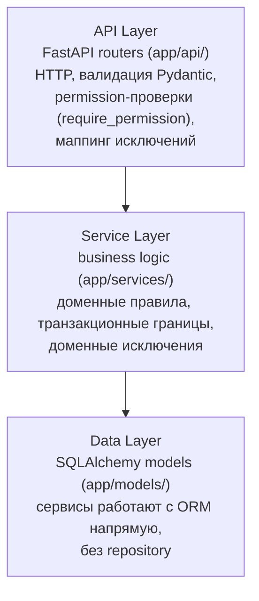

# Сервисный слой без repository pattern: бизнес-логика в `app/services/`, доменные исключения, прямой доступ к SQLAlchemy ORM

## Context and Problem Statement

Backend-стек зафиксирован в [ADR-0001](0001-choose-backend-stack.md), но слоение backend-кода до сих пор нигде официально не зафиксировано: как устроен поток «API → бизнес-логика → данные», где живут доменные исключения и нужен ли repository-слой поверх SQLAlchemy ORM. Решение существует только в коде и частично в `plans/architecture/decisions.md` (файл смешивает актуальные и legacy-решения, источник истины — код).

Фактический вопрос: **принимать ли существующее слоение как стандарт проекта** — сервисный слой с доменными исключениями и прямым доступом к SQLAlchemy ORM, без repository-абстракции?

## Decision Drivers

- Бизнес-логика должна вызываться не только из HTTP-endpoints: scheduler (`scheduler.py`, `sync_scheduler.py`), фоновые задачи и будущий CLI переиспользуют те же сервисы
- Тестируемость без HTTP-контекста: сервисы поднимаются в pytest подстановкой `AsyncSession`, без FastAPI `TestClient`
- Транспортная независимость сервисов: `HTTPException` в бизнес-логике делает её непригодной вне FastAPI
- Минимализм (принят в ADR-0001): каждый слой — цена поддержки; дополнительная абстракция оправдана только реальной потребностью
- SQLAlchemy 2 async уже является типизированной абстракцией над SQL — дублирующая абстракция не добавляет выразительности

## Considered Options

* Service layer + доменные исключения + прямой SQLAlchemy ORM (фактический стандарт кода)
* Service layer + repository pattern (репозитории на агрегат, сервисы поверх репозиториев)
* CQRS (разделение команд и запросов на уровне приложения)
* Fat routers (бизнес-логика прямо в FastAPI-роутерах)

## Decision Outcome

Chosen option: **Service layer + доменные исключения + прямой SQLAlchemy ORM** — это уже работающий стандарт кода (20+ сервисов в `backend/app/services/`), он даёт тестируемость без HTTP и переиспользование вне API при минимальном числе слоёв. Repository-слой поверх SQLAlchemy признан overengineering: ORM уже абстракция, а репозитории добавили бы слой WITHOUT реальных точек замены хранилища (PostgreSQL зафиксирован в ADR-0001).

Каноническое слоение:



Правила слоения:

1. **Сервис получает `AsyncSession` в конструкторе** и не знает о FastAPI: `def __init__(self, db: AsyncSession) -> None` (пример: `TeamService`, `RBACService` в `backend/app/services/`)
2. **Сервисы не импортируют `fastapi`** и не выбрасывают `HTTPException` — только доменные исключения из `app/core/exceptions.py`
3. **Доменные исключения — два вида** (оба уже в `app/core/exceptions.py`):
   - `DomainError(detail, status_code)` — общий механизм: plain `Exception` c HTTP-статусом; глобальный handler в `app/main.py` (`@app.exception_handler(DomainError)`) маппит его в JSON-ответ, так что роутеру часто не нужен try/except
   - специализированные plain-исключения (`RoleNotFoundError`, `OIDCError`-иерархия и др.) — для слоёв, где важна типовая обработка; API-слой ловит их в try/except и маппит в `HTTPException` (пример: `backend/app/api/admin.py` ловит `RoleNotFoundError`)
   - legacy `HTTPException`-подклассы (`NotFoundError` и т.п.) в том же файле — достояние API-слоя; новым сервисам их не использовать
4. **API-роутер тонкий**: permission-зависимости, вызов сервиса, сериализация ответа, маппинг доменных исключений в HTTP
5. **Роутер может использовать `HTTPException` для transport-проверок** (например, «not a team lead» в `app/api/teams.py`), но не для бизнес-правил — бизнес-правила проверяет сервис

### Consequences

* Good, because сервисы тестируются unit-тестами без FastAPI: `backend/tests/unit/test_rbac_scope.py` поднимает `RBACService` на сессии и проверяет `pytest.raises(RoleNotFoundError)`
* Good, because scheduler и фоновые задачи вызывают те же сервисы, что и endpoints — одно место бизнес-правил
* Good, because меньше кода: нет интерфейсов репозиториев, их реализаций и DI-обвязки
* Bad, because смена СУБД или добавление второго хранилища потребует рефакторинга всех сервисов (принятый риск: PostgreSQL зафиксирован, сценарий не прогнозируется)
* Bad, because смешение query-логики с бизнес-правилами в сервисах может раздувать файлы (частично решается пакетами: `providers/`, `pipeline/`, `gitlab_projects/` — сервис из директории с файлами по ответственности)
* Neutral, because дисциплина «сервис не импортирует fastapi» держится на ревью и fitness-проверке (см. Confirmation), а не на механизме языка
* Non-goals: repository/UoW-абстракции; CQRS; внедрение DI-фреймворка; миграция legacy `HTTPException`-подклассов в `exceptions.py` (отдельная задача, не эта)

### Confirmation

Fitness-проверка слоя (выполняется при ревью и вручную по мере надобности):

```bash
# 1. Сервисный слой не зависит от FastAPI (ожидание: пустой вывод)
grep -rn "from fastapi" backend/app/services/

# 2. Сервисы не выбрасывают HTTPException (ожидание: только комментарии-пояснения)
grep -rn "HTTPException" backend/app/services/ --include="*.py" | grep -v "instead of HTTPException"

# 3. Доменные исключения определены как plain-исключения, а не HTTPException-подклассы:
#    в backend/app/core/exceptions.py классы DomainError/RoleNotFoundError/OIDCError*
#    наследуют Exception/RuntimeError, а не fastapi.HTTPException
```

Контрольный пример unit-теста сервиса без HTTP: `backend/tests/unit/test_rbac_scope.py` — `RBACService` создаётся с `AsyncSession`, бизнес-ошибка проверяется как `pytest.raises(RoleNotFoundError)`. Запуск:

```bash
make test-unit-backend TEST_ARGS="tests/unit/test_rbac_scope.py -v"
```

Ожидаемый результат: все тесты проходят, ни один не поднимает FastAPI-приложение.

## Pros and Cons of the Options

### Service layer + доменные исключения + прямой SQLAlchemy ORM — chosen

Фактический стандарт кода; сервисы в `app/services/`, исключения в `app/core/exceptions.py`.

* Good, because переиспользование из scheduler/CLI/фоновых задач без HTTP
* Good, because unit-тесты без FastAPI (см. Confirmation)
* Good, because меньше кода: ORM — уже абстракция над SQL
* Bad, because сервисы привязаны к SQLAlchemy-сессии — смена хранилища = рефакторинг

### Service layer + repository pattern

Репозитории на каждый агрегат (`MirrorRepository`, `TeamRepository`), сервисы работают с репозиториями.

* Good, because подмена реализации данных в тестах без реальной БД
* Good, because query-логика вынесена из сервисов
* Bad, because SQLAlchemy уже абстракция; дублирующий слой без реальной смены СУБД — overengineering (драйвер выбора хранилища отсутствует, PostgreSQL зафиксирован ADR-0001)
* Bad, because 20+ существующих сервисов пришлось бы переписывать ради архитектурной чистоты без измеримой пользы

### CQRS

Разделение команд и запросов: отдельные модели записи и чтения, обработчики команд.

* Good, because независимая эволюция read/write-моделей; потенциал для read-реплик
* Bad, because несовместимо с масштабом проекта: единая PostgreSQL-БД, нет реплик, нагрузка не требует разделения
* Bad, because удвоение числа классов/обработчиков — прямое противоречие драйверу «минимализм»

### Fat routers

Бизнес-логика прямо в FastAPI-роутерах, сервисный слой отсутствует.

* Good, because минимальное число файлов и слоёв для простых случаев
* Bad, because логика недоступна из scheduler/фоновых задач — пришлось бы дублировать
* Bad, because тестирование бизнес-правил требует HTTP-контекста (`TestClient`)
* Bad, because противоречит существующему коду (20+ сервисов) и конвенции `app/services/`

## More Information

- Домены и фичи: `plans/features/` (например, `auth-rbac.md` — описание `RoleNotFoundError`, `security.md` — шифрование credentials; Providers V3 зафиксирован в [ADR-0007](../common/0007-providers-v3-registry.md))
- Исходная фиксация решения (устаревает по мере распределения контента): `plans/architecture/decisions.md`, разделы «Service Layer» и «Repository Pattern: НЕ используется»; удаление файла — в ADR-0022, не здесь
- Реестр ADR и конвенции: [docs/adr/README.md](../README.md)
- Родственные ADR: [ADR-0001](0001-choose-backend-stack.md) (стек; PostgreSQL зафиксирован — ключевой аргумент против repository)
- Условие пересмотра: появление второго хранилища данных (например, search-индекс или объектное хранилище в транзакционном контуре) или систематическое дублирование query-логики между сервисами — переоткрыть через новый ADR
