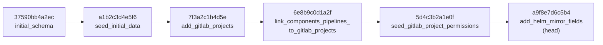

# Зафиксировать database layer: PostgreSQL 17 + SQLAlchemy 2 (async) + Alembic, naming conventions, status flags, политика миграций

## Context and Problem Statement

Стек зафиксирован в [ADR-0001](0001-choose-backend-stack.md), но решения по слою данных — выбор СУБД/ORM-режима, naming conventions, единый статус-флаг, политика цепочки миграций — существовали только в `docs/development/database.md`. Этот документ смешивал актуальные решения с устаревшими фактами (список таблиц всё ещё содержал legacy `gitlab_instances`/`harbor_instances` и не содержал `resource_providers`/`gitlab_projects`; примеры моделей показывали `Mapped[]`-стиль, тогда как код использует legacy `Column()`; драйвер Alembic указан как psycopg2, тогда как `alembic/env.py` работает через async engine). Источник истины — код: `backend/app/models/` и `backend/alembic/versions/`.

Фактический вопрос: **принять ли существующий database layer как стандарт проекта** и перенести его правила в ADR, заменив собой `docs/development/database.md`?

Фактическое состояние (проверено по коду, 2026-10-21):

- СУБД — **PostgreSQL 17** (docker-образ `postgres:17`, два инстанса: backend + keycloak), драйвер **asyncpg >= 0.29**
- ORM — **SQLAlchemy >= 2.0** в async-режиме (`AsyncSession`, `async_sessionmaker`), но модели объявлены в **legacy-стиле `Column()`** без `Mapped[]`/`mapped_column` (см. `ponytail`-комментарий в `backend/pyproject.toml` и плагин `sqlalchemy.ext.mypy.plugin`)
- Миграции — **Alembic >= 1.13**, async engine, `sqlalchemy.url` берётся из pydantic-настроек (в `alembic.ini` не хранится), `target_metadata = Base.metadata` c `compare_type`/`compare_server_default`
- Схема — ~40 таблиц (39 ORM-классов + ассоциативная `role_permissions`), полный перечень — `backend/app/models/__init__.py`; этот ADR намеренно не дублирует список таблиц (он устареет раньше самого ADR)

## Decision Drivers

- Реляционная модель проекта: users/roles/RBAC, providers, mirrors, schedules — ACID, FK и JOIN обязательны (унаследовано из ADR-0001)
- Async-first backend: все запросы к БД идут из async-контекста FastAPI и APScheduler — синхронный драйвер блокировал бы event loop
- Одна БД на всех: сценарий смены СУБД не прогнозируется (PostgreSQL зафиксирован), поэтому абстракции над ORM не нужны
- Унификация статусов: все доменные сущности (`mirrors`, `pipelines`, providers, образы, логи) отчитываются единым `status_flag`/`status_text` — фронтенд и API полагаются на одну шкалу
- Боль миграций уже пережита: цепочка из 40 ревизий деградировала (зеркалила ручные скрипты сидов, ломалась о RBAC), из-за чего 2026-08-16 её сбросили

## Considered Options

* PostgreSQL 17 + SQLAlchemy 2.0 async (legacy `Column()`) + Alembic — фактический стандарт кода
* PostgreSQL + SQLModel (Pydantic-модели как ORM-модели)
* PostgreSQL + SQLAlchemy 2.0 async с `Mapped[]`/`mapped_column` (модернизация стиля моделей)
* MySQL 8 / MariaDB + SQLAlchemy 2.0 async
* MongoDB + Motor (document store)

## Decision Outcome

Chosen option: **PostgreSQL 17 + SQLAlchemy 2.0 async (legacy `Column()`) + Alembic** — это работающий стандарт кода (39 моделей, 6 миграций), он согласован с ADR-0001 и ADR-0005 (сервисы работают с ORM напрямую) и не требует ни одной строки рефакторинга.

### Зафиксированные правила

**1. Конфигурация БД** (`backend/app/database.py` — эталон):

- единственный `create_async_engine` на приложение: `pool_pre_ping=True`, `pool_size=10`, `max_overflow=20`, `echo=settings.debug`
- `async_sessionmaker(expire_on_commit=False, autocommit=False, autoflush=False)`
- `get_db()` — request-scoped сессия с commit-on-success / rollback-on-error (транзакционная граница — один HTTP-запрос); вне запросов сервисы сами управляют сессией
- URL БД — только через pydantic-settings (`settings.database_url`), нигде не хардкодится (включая `alembic/env.py`, который переопределяет `sqlalchemy.url`)

**2. Naming conventions**:

| Объект | Правило | Пример |
|---|---|---|
| Таблицы | plural, snake_case | `users`, `gitlab_mirrors`, `role_scope_providers` |
| Колонки | snake_case | `user_id`, `created_at`, `is_active` |
| Булевы флаги | префикс `is_` / `has_` | `is_active`, `is_deleted`, `is_default` |
| Временные метки | суффикс `_at`, `DateTime(timezone=True)` | `created_at`, `last_sync_at` |
| Внешние ключи | `{родитель}_id` (в ед. числе) | `user_id`, `source_repository_id` |
| Индексы | `ix_{table}_{column}` | `ix_users_email` |
| Уникальные | `uq_{table}_{столбцы}` (возможен partial: `postgresql_where`) | `uq_resource_providers_name` |
| Check-ограничения | `ck_{table}_{правило}` | `ck_resource_providers_private_owner` |
| FK-констрейнты | `fk_{table}_{column}` — правило для **новых** миграций; в существующей схеме FK безымянные, переименовывать задним числом запрещено | `fk_mirrors_source_repository_id` |
| Модели | один файл = одна модель, `app/models/<сущность>.py` | `app/models/mirror.py` |

**3. Единый статус-флаг** (`status_flag: int NOT NULL` + `status_text: str`):

| Значение | Смысл | Типовой default |
|---|---|---|
| 0 | OK / Success | |
| 1 | Failed | |
| 2 | Warning / Stale | |
| 3 | In Progress / Running | |
| 4 | Pending | default для сущностей «ещё не обработанных» |

- Константы именованные (`STATUS_OK`…`STATUS_PENDING`, см. `backend/app/services/pipeline/_status.py`, там же маппинг GitLab-статусов); в схемах API — `Field(description="0=OK, 1=Failed, ...")`. Новым сущностям запрещено вводить собственные шкалы статусов.
- Сущности, созданные и ожидающие первой синхронизации, стартуют с `4/Pending`; синхронизированные инстансы провайдеров — с `0/OK`.

**4. Политика миграций Alembic**:

- **Новые изменения схемы — только новой миграцией поверх текущего head**. Редактировать уже применённые миграции (`initial_schema`, `seed_initial_data` и далее) запрещено.
- Текущая цепочка после сброса 2026-08-16 (40 старых ревизий — в `backend/alembic/versions_backup_20260816/`, Alembic их не читает):



- **Сиды**: канонические данные (роли, permissions, связи ролей) сидируются идемпотентными миграциями (`seed_initial_data`, `seed_gitlab_project_permissions`): вставляются только отсутствующие строки, `downgrade()` удаляет только свои. Динамические данные (админ-пользователь, встроенные провайдеры) — НЕ в миграциях: их создают `backend/docker/seed_admin.py` и `backend/scripts/seed_providers.py`, которые entrypoint запускает после `alembic upgrade head`.
- Каждая миграция обязана иметь рабочий `downgrade()`.
- Расхождение веток (несколько heads) разрешается `alembic merge` до push.
- Регресс-тест цепочки: `backend/tests/unit/test_permission_seed_migration.py` прогоняет `alembic upgrade head` на throwaway PostgreSQL и проверяет содержимое `permissions`/`role_permissions` (см. Confirmation).

**5. Стиль моделей**: legacy-декларативный `Column()` — осознанный консерватизм (см. комментарий в `backend/pyproject.toml`). Перевод моделей на `Mapped[]`/`mapped_column` допускается инкрементально отдельными PR с удалением модуля из mypy-override-списка; массовая конвертация не планируется.

### Consequences

* Good, because ноль рефакторинга: решения фиксируют существующий код, а не желаемое будущее
* Good, because источник истины для схемы — один (`app/models/` + цепочка миграций); устаревший doc удалён вместе с риском скопировать stale-факты
* Good, because единая шкала статусов избавляет frontend и API от per-domain трансляций
* Bad, because legacy `Column()` теряет преимущества SQLAlchemy 2 typing (`Mapped[]`); компенсируется mypy-плагином, миграция — инкрементально
* Bad, because безымянные FK в существующей схеме усложняют точечные `drop_constraint` в будущих миграциях (новые — по правилу `fk_`)
* Neutral, because список таблиц не дублируется в ADR: источник истины — `app/models/__init__.py`, который меняется чаще документа
* Non-goals: перевод моделей на `Mapped[]` массово; внедрение repository/UoW (запрещено ADR-0005); multi-tenancy/sharding; read-реплики; смена СУБД

### Confirmation

1. **Миграции применяются с base до head и обратно** — регресс-тест сидов и цепочки:

```bash
make test-unit-backend TEST_ARGS="tests/unit/test_permission_seed_migration.py -v"
```

Ожидаемый результат: тест создаёт throwaway PostgreSQL, выполняет `alembic upgrade head`, проверяет сиды RBAC; при недоступности PostgreSQL — skip.

2. **Единый статус-флаг** — при ревью: новая модель со статусом обязана иметь `status_flag Integer NOT NULL` со значениями 0–4 и `status_text`; проверка вручную:

```bash
# ожидание: только значения 0-4 в дефолтах и маппингах, никаких своих шкал
grep -rn "status_flag" backend/app/models/ | grep -v "default=[0-4]"
```

3. **Naming conventions** — при ревью миграций: имена индексов/констрейнтов соответствуют таблице правил выше; `alembic upgrade head` не создаёт безымянных индексов и констрейнтов.

## Pros and Cons of the Options

### PostgreSQL 17 + SQLAlchemy 2.0 async (legacy `Column()`) + Alembic — chosen

Фактический стандарт кода.

* Good, because зрелый async-стек: asyncpg + AsyncSession, ничего не блокирует event loop
* Good, because полный контроль над SQL и схемой; Alembic — де-факто стандарт миграций для SQLAlchemy
* Good, because работает сегодня: 39 моделей, 6 миграций, регресс-тест цепочки
* Bad, because legacy-стиль моделей проигрывает в типизации `Mapped[]` (модули в mypy-override)

### PostgreSQL + SQLModel

Pydantic-модели совмещены с ORM-моделями.

* Good, because одна модель для валидации и ORM — меньше дублирования
* Bad, because SQLModel отстаёт от SQLAlchemy 2 API (нет полной поддержки async-фишек и legacy-инфраструктуры проекта)
* Bad, because переписывание 39 моделей и всех сервисов (ADR-0005) ради эстетики — без функциональной выгоды

### SQLAlchemy 2.0 async с `Mapped[]`/`mapped_column`

Тот же стек, но современный стиль объявления моделей.

* Good, потому что типизированные атрибуты без mypy-плагина, меньше override-конфигурации
* Bad, потому что чисто механическая переработка 39 файлов без изменения поведения
* Recognized as направление, но не как решение: допустима инкрементальная миграция отдельных моделей (см. правило 5)

### MySQL 8 / MariaDB + SQLAlchemy 2.0 async

* Good, because шире распространён в hosted-средах
* Bad, потому что проект уже использует PostgreSQL-специфику (partial unique indexes с `postgresql_where`, JSONB)
* Bad, потому что миграция ради миграции: нет ни одной проблемы, которую MySQL решает лучше

### MongoDB + Motor

* Good, because гибкая схема для быстро меняющихся объектов
* Bad, because реляционная доменная модель (RBAC, FK-каскады, M2M) выражается в document store больно: JOIN'ы и транзакции — второсортны
* Bad, потому что противоречит драйверу «реляционная модель обязательна» (унаследован из ADR-0001)

## More Information

- Родственные ADR: [ADR-0001](0001-choose-backend-stack.md) (стек: PostgreSQL 17, SQLAlchemy 2, Alembic), [ADR-0005](0005-service-layer-no-repository.md) (сервисы работают с ORM напрямую — этот ADR фиксирует, с чем именно)
- Реестр ADR и конвенции: [docs/adr/README.md](../README.md)
- Источник истины по схеме: `backend/app/models/__init__.py` (перечень моделей), `backend/alembic/versions/` (цепочка миграций), `backend/app/database.py` (engine/сессии)
- Политика прав: `docs/development/permissions.md`; RBAC-сиды — миграции `seed_initial_data`/`seed_gitlab_project_permissions`
- Условие пересмотра: потребность в втором хранилище (search-индекс, объектное хранилище), массовая конвертация моделей на `Mapped[]`, либо поломка цепочки миграций, требующая нового сброса — переоткрыть через новый ADR
- Данный ADR полностью замещает `docs/development/database.md` (удалён); how-to-примеры (SQLAlchemy-запросы, команды Alembic, troubleshooting) не переносились как общеизвестная документация самих инструментов
