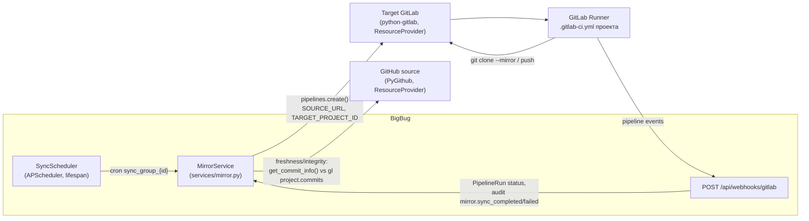

# Архитектура Git Mirroring: pull-based синхронизация GitHub → GitLab с оркестрацией через GitLab CI/CD pipeline

## Context and Problem Statement

Git Mirroring — самая функционально полная подсистема BigBug (домен V2, 9 реализованных этапов): CRUD зеркал, расписания синхронизации, Sync Groups, integrity check, soft delete/restore, orphaned mirrors, отчёты, bulk-операции. До сих пор она была описана только как feature-спека в `plans/features/git-mirroring-v2.md` (user stories, писавшиеся **до** реализации). Спека не фиксирует принятые архитектурные решения и частично расходится с кодом.

Вопрос: **зафиксировать как стандарт проекта фактическую архитектуру зеркалирования** — pull-based по расписанию, перенос кода силами GitLab CI/CD, soft delete с retention, — чтобы источник истины для агентов и ревьюеров стал ADR, а не устаревающая спека.

Домен строится поверх системы Providers V3 (единый реестр `resource_providers`; см. [ADR-0007](../common/0007-providers-v3-registry.md)) и сервисного слоя без repository (см. [ADR-0005](0005-service-layer-no-repository.md)).

### Traceability to Analytics

Мотивирующие артефакты аналитики (нормативные требования, не описание кода):

- **User stories**: [docs/analitics/stories/git-mirroring.md](../../analitics/stories/git-mirroring.md) — US-gitmrr-001..012 (источники, зеркала, sync, расписания, health, orphaned, жизненный цикл).
- **Use cases**: [docs/analitics/use-cases/git-mirroring.md](../../analitics/use-cases/git-mirroring.md) — UC-gitmrr-001..010, включая UC-gitmrr-005 (запись результата sync через webhook) и UC-gitmrr-009 (обнаружение и remediation orphaned).
- **Edge cases**: [docs/analitics/edge-cases/git-mirroring.md](../../analitics/edge-cases/git-mirroring.md) — EC-gitmrr-001..048; нормативные строки, фиксирующие требуемое поведение на известных разрывах реализации: EC-gitmrr-008 (target не привязан → осмысленный not-ready-контракт, не generic 400 — grill #142/H1), EC-gitmrr-020 (webhook без аутентификации отклоняется — ADR-0025, grill #139/C1), EC-gitmrr-034/035/036 (orphaned remediation end-to-end — grill #140/C4), EC-gitmrr-018/019 (permission на integrity-check/orphaned — grill #139/C3), EC-gitmrr-046/047 (финализация статуса зеркала; расписание без рестарта — grill #142/H4), EC-gitmrr-045 (контракт переменных sync-пайплайна против CI-пресета).

Эти строки — требования к коду, а не признание текущего поведения; разрывы реализации ведутся в перечисленных гриллах (#139, #140, #142).

## Decision Drivers

- BigBug — **оркестратор**, а не git-воркер: перенос кода не должен требовать git-бинарника, дискового пространства под клоны и обработки LFS в backend-контейнере
- Rate limits GitHub API: расписания и конкурентность должны настраиваться пользователем, а не быть жёсткими константами
- Единица расписания — группа зеркал (сотни зеркал в организации не настраиваются по одному)
- Безопасность отказов: удаление зеркала — обратимая операция; физическое удаление записи не должно трогать целевой GitLab-проект
- Целостность: зеркало существует, чтобы ему доверяли; нужна детекция ручных коммитов в target
- Минимализм (принят в ADR-0001): переиспользовать APScheduler, python-gitlab, PyGithub и существующий сервисный слой, не вводя брокеров задач и воркеров

## Considered Options

- Механизм переноса: **GitLab CI/CD pipeline на целевом проекте** (chosen) / git-операции в backend (`git clone --mirror` + push через subprocess) / GitLab push mirror API (remote mirrors)
- Обнаружение изменений: **pull-based по cron-расписанию Sync Groups** (chosen) / GitHub webhooks на backend / интервальный поллинг всех зеркал
- Удаление: **soft delete с retention-периодом и cleanup-джобой** (chosen) / немедленное hard delete
- Проверка целостности: **direct-сравнение HEAD-коммита через API source и target** (chosen, endpoint) / audit CI/CD pipeline (реализовано в сервисе, endpoint отсутствует)

## Decision Outcome

Chosen option: **pull-based синхронизация по cron-расписаниям Sync Groups, где перенос кода выполняет CI/CD pipeline на целевом GitLab-проекте, а BigBug только триггерит его через API и собирает результаты** — это реализованный стандарт (9 этапов V2 в коде). Фактическая модель:



Зафиксированные решения (как реализовано):

1. **Модель данных.** Цепочка `SourceGroup` → `SourceRepository` → `Mirror` (таблицы `source_groups`, `source_repositories`, `mirrors`; модели в `backend/app/models/{source_group,source_repository,mirror}.py`). Зеркало хранит веб-URL источника (не git-ссылку) и целевые `target_namespace` / `target_project_name` / `target_project_id` / `target_web_url`. Привязка провайдеров идёт через Providers V3: source — `SourceRepository.provider_id` → `ResourceProvider` (git-провайдер, credentials в Fernet-шифрованном `credential.encrypted_secret`); target — `Mirror` → `SyncGroup` → `Pipeline` → `ResourceProvider` (subtype `gitlab`, category `system`, direction `internal`). Прямого FK зеркало → GitLab-инстанс нет.
2. **Перенос кода — CI/CD pipeline целевого GitLab.** `MirrorService.trigger_sync` не выполняет git-операций: он резолвит pipeline группы, передаёт переменные `SOURCE_URL` / `TARGET_PROJECT_ID` / `TARGET_PROJECT_PATH` (поверх `pipeline.default_variables`) и создаёт pipeline через python-gitlab (`project.pipelines.create()`). Что именно делает перенос (clone --mirror, push, LFS), определяет `.gitlab-ci.yml` целевого проекта — backend не знает и не контролирует механику. Результаты приходят обратно webhook'ом `POST /api/webhooks/gitlab` → обновление `PipelineRun` → audit-события `mirror.sync_completed` / `mirror.sync_failed` (связь через `MirrorLog.pipeline_run_id`).
3. **Расписание — pull-based, cron в Sync Group.** GitHub webhooks не используются. `SyncScheduler` (`services/sync_scheduler.py`, инстанс в `app.state`, запускается в lifespan) для каждой активной Sync Group создаёт APScheduler job с `CronTrigger.from_crontab` из полей `sync_cron` / `freshness_cron` (строки ≤100 символов, nullable; disabled-поле отдельно). Конкурентность — `asyncio.Semaphore` на группу (`sync_concurrency` / `freshness_concurrency`, default 5) — rate limiting источника регулируется настройкой группы. Ручные триггеры: `POST /mirrors/{id}/sync`, `POST /mirrors/{id}/freshness`. Персона запуска — `triggered_by`: `scheduler` (username "system") | `manual` | `webhook`.
4. **Sync Groups — единица расписания и привязки pipeline.** many-to-one (зеркало ∈ ровно одна группа). Default-группа автосоздаётся (`SyncGroupService.get_default_group`) вместе с default-pipeline — контейнер без операций. Удаление группы запрещено для default; зеркала удаляемой группы мигрируют в default. API: CRUD `/api/mirroring/sync-groups`, bulk-assign зеркал (≤100), `apply-pipeline`.
5. **Свежесть и целостность — on-demand API-сравнения.** Freshness (`log_type=freshness`): лёгкое сравнение последнего коммита → `FRESH` / `STALE` / `ERROR`. Integrity check (`log_type=integrity`), endpoint `POST /mirrors/{id}/integrity-check`: сравнение HEAD-коммита default-ветки — source через `BaseSourceProvider.get_commit_info()` (PyGithub), target через python-gitlab — статусы `MATCH` (flag 0) / `MISMATCH` (flag 2, инкремент `target_diverged_commits`) / `ERROR` (flag 1). Все результаты — записи `mirror_logs` c `details` JSON и обновлением `status_flag`/`status_text` зеркала. Pipeline-based вариант `check_integrity` (audit-pipeline, `CHECK_TYPE=integrity`) существует в сервисе без API-endpoint — не основной путь.
6. **Soft delete с retention, cleanup не трогает GitLab.** Флаги `is_deleted`/`deleted_at` на `Mirror`, `SyncGroup`, `SourceRepository`, `SourceGroup`, `Pipeline`. `CleanupService.run_cleanup` (`services/cleanup.py`) выполняется ежедневно (cron, час `cleanup_cron_hour`=3) и вручную (`POST /api/admin/cleanup`, permission `system:config`); retention `soft_delete_retention_days` = **30 дней** (не 7, как в ранних набросках). Порядок каскада: MirrorLog'и удалённых зеркал → Mirror → SyncGroup (если нет активных зеркал) → SourceRepository → SourceGroup → Pipeline. Физическое удаление затрагивает **только записи БД**; целевые GitLab-проекты не удаляются. Restore (`POST .../restore`) каскадно восстанавливает удалённый SourceRepository. `mirror_release_logs` отдельного cleanup не имеет — уходит каскадом FK при удалении SourceRepository (журнал обнаруженных релизов источника).
7. **Orphaned mirrors — on-demand детекция, отчёт без автодействий.** `OrphanedMirrorService` (`services/orphaned.py`): GitLab-проект целевого инстанса считается orphaned, если его numeric id отсутствует среди `Mirror.target_project_id` активных зеркал. Единственный endpoint `GET /api/mirroring/orphaned-mirrors` — отчёт; GitLab-проекты не изменяются.
8. **Отчёты и bulk.** `ReportsService` (`services/reports.py`, permission `reports:read`): дубликаты (одинаковый `source_url`), занимаемое место (GitLab statistics, in-memory кэш 24h), распределение статусов, активность синхронизаций за период — каждый с экспортом CSV/JSON. Bulk: `POST /mirrors/bulk` (создание ≤500, с duplicate-warning — не блокировка), `POST /bulk/reassign-sync-group`, `POST /bulk/change-target-gitlab`, `POST /bulk/apply-pipeline`. RBAC-scope применяется в `get_mirrors`.

### Consequences

- Good, because backend остаётся лёгким: ни git-бинарника, ни места под клоны, ни LFS-трафика — вся тяжёлая работа на раннерах целевого GitLab
- Good, because расписание и rate limiting настраиваются пользователем на уровне групп (cron + Semaphore) без деплоя/рестарта кода
- Good, because удаление обратимо 30 дней, а cleanup гарантированно не разрушает данные в GitLab
- Good, because каждая sync/freshness/integrity-операция оставляет запись в `mirror_logs` + audit-событие — полная наблюдаемость
- Bad, because механика переноса вынесена в `.gitlab-ci.yml` целевых проектов: BigBug не контролирует и не верифицирует её; шаблоны CI в репозитории отсутствуют
- Bad, because **`Mirror.target_project_id` не проставляется автоматически** при создании зеркала (заполняется вне приложения), а sync/freshness/integrity без него возвращают 400 — известное ограничение текущей реализации
- Bad, because изменения cron/конкурентности группы подхватываются планировщиком только при рестарте приложения: API не вызывает `schedule_all_jobs` после PATCH группы
- Bad, because pipeline webhook обновляет `PipelineRun` и audit, но не `Mirror.status_flag` напрямую — статус зеркала актуализируется следующими операциями
- Bad, because relink/move/delete для orphaned-зеркал вызываются frontend'ом (`orphaned.ts`: `POST /orphaned/{id}/reassign`, `/move-target`, `DELETE`), но **backend-endpoints отсутствуют** — UI-поток relink не работает end-to-end
- Neutral, because GitHub webhooks не используются — обнаружение новых/удалённых репозиториев источника ограничено частотой refresh групп (осознанный отказ от push-модели)
- Non-goals: push-модель через GitHub webhooks; выполнение git-операций в backend; автоматический relink orphaned-зеркал (требуется backend-реализация — отдельная задача); автоматическое проставление `target_project_id`; шаблоны CI в репозитории BigBug

### Confirmation

Контрольные unit-тесты, покрывающие решения 2–8:

```bash
# Решение 2-3: trigger_sync создаёт PipelineRun+MirrorLog; без pipeline — skip;
# планировщик: cron-джобы, Semaphore, resolver пользователя "system"
make test-unit-backend TEST_ARGS="tests/unit/test_sync_scheduler.py tests/unit/test_mirror_service.py -v"

# Решение 5: integrity direct — MATCH/MISMATCH/ERROR + запись mirror_logs
make test-unit-backend TEST_ARGS="tests/unit/test_integrity_check.py -v"

# Решение 6: retention 30 дней, каскадный порядок, keep-with-active-* инварианты
make test-unit-backend TEST_ARGS="tests/unit/test_cleanup.py tests/unit/test_soft_delete.py -v"

# Решение 7: детект orphaned-проектов
make test-unit-backend TEST_ARGS="tests/unit/test_orphaned.py -v"
```

Ожидаемый результат: все тесты проходят. Известные разрывы (не покрыты тестами по определению): relink-endpoints orphaned (их нет в backend), автопланирование после PATCH группы — при ревью изменений планировщика проверять вручную, что `schedule_all_jobs` вызывается после мутаций SyncGroup.

## Pros and Cons of the Options

### GitLab CI/CD pipeline на целевом проекте — chosen

BigBug триггерит pipeline через python-gitlab; перенос выполняет раннер целевого GitLab.

- Good, because нулевые требования к backend-контейнеру (нет git, нет диска под клоны, нет LFS)
- Good, because раннеры целевого GitLab гарантированно имеют сетевой доступ к target — не надо открывать доступ backend'у к GitLab-хранилищу
- Good, because логи переноса видны нативно в GitLab UI; BigBug получает статус через webhook
- Bad, because механика определяет `.gitlab-ci.yml` целевого проекта — вне контроля BigBug, шаблоны не версируются в репозитории
- Bad, because нужен заполненный `target_project_id` и настроенный pipeline на группе (см. Consequences)

### Git-операции в backend (`git clone --mirror` + push)

Backend выполняет git через subprocess, хранит временные клоны.

- Good, because полный контроль механики и шаблоном в репозитории BigBug
- Good, because не нужен CI/CD pipeline на группе
- Bad, because git-бинарник + дисковая квота + LFS-трафик в backend-контейнере; очистка temp-клонов — новая категория проблем
- Bad, because backend'у нужен прямой сетевой доступ к git-endpoint целевого GitLab

### GitLab push mirror API (remote mirrors)

Настройка push-зеркала средствами самого GitLab через API.

- Good, because нулевая нагрузка на BigBug после настройки
- Bad, because источник не всегда доступен целевому GitLab (GitHub private-репо требуют секретов на стороне GitLab); Granular контроль расписания/статусов в BigBug теряется
- Bad, because не покрывает freshness/integrity/отчёты — их всё равно пришлось бы строить поверх API; rejected на этапе V2-спеки

### Pull-based cron (SyncScheduler) vs GitHub webhooks — chosen: cron

- Good, because не требует публичной доступности backend и секретов webhook'ов; GitHub не должен достукиваться до BigBug
- Good, because cron настраивается per-group вместе с конкурентностью — прямой контроль rate limits
- Bad, because задержка обнаружения изменений источника = период cron (для актуального зеркала приемлемо)

### Soft delete + retention — chosen vs hard delete

- Good, because отказ «удалил не то» обратим 30 дней; cleanup каскадирует в правильном порядке и не трогает GitLab
- Bad, because нужен cleanup-джоба и учёт `is_deleted` в каждом запросе списков (принято)

## More Information

- Реализация: API `backend/app/api/mirroring.py` (`/api/mirroring`), сервисы `backend/app/services/{mirror,sync_group,sync_scheduler,orphaned,cleanup,reports,source_repository}.py`, модели `backend/app/models/{mirror,mirror_log,mirror_release_log,sync_group,source_group,source_repository}.py`; webhook `backend/app/api/webhooks.py` (`POST /api/webhooks/gitlab`)
- Frontend: страницы `frontend/src/pages/GitMirroring/` (Dashboard, Mirrors, Sources, SyncGroups, Orphaned, Reports), RTK Query `frontend/src/store/api/git-mirroring/`
- Замечания по расхождениям спеки и кода, учтённые здесь: retention — 30 дней (не 7); sync-механизм — CI/CD pipeline (спека US-7 предполагала API-сравнение как freshness — реализовано отдельно); integrity «deep comparison» из US-15 реализован как direct HEAD-сравнение
- Аналитика домена (2026-10-26, issue #159): stories/use-cases/edge-cases в `docs/analitics/{stories,use-cases,edge-cases}/git-mirroring.md` — нормативный слой требований; трассировка в §Context. Известные разрывы реализации (target_project_id-контракт H1, orphaned remediation C4, webhook-финализация H4, permission-гапы C3, пресет/переменные sync) зафиксированы как строки каталога EC-gitmrr и ведутся в гриллах #139/#140/#142
- Единые status flags (0 OK / 1 Failed / 2 Warning / 3 In Progress / 4 Pending) — `status_flag`/`status_text` на зеркалах и логах
- Родственные ADR: [ADR-0005](0005-service-layer-no-repository.md) (сервисный слой), [ADR-0007](../common/0007-providers-v3-registry.md) (Providers V3 — реестр `resource_providers`, на котором строятся привязки source/target), [ADR-0006](0006-database-postgresql-alembic.md) (database layer)
- Заменил feature-спеку `plans/features/git-mirroring-v2.md` (удалена); переоценивать решение при: потребности в push-модели (real-time зеркалирование), появлении второго source-хостинга вне provider-реестра, необходимости автоматического relink orphaned
- Реестр ADR и конвенции: [docs/adr/README.md](../README.md)
