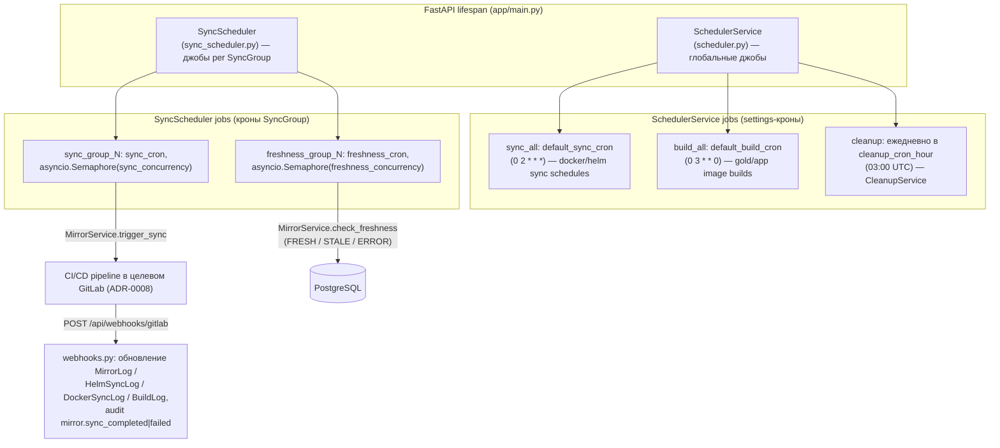

# Фоновая синхронизация: pull-based через APScheduler с опциональными webhooks

## Context and Problem Statement

Домен Git Mirroring зафиксирован в [ADR-0008](0008-git-mirroring-github-gitlab.md), но модель **исполнения** синхронизации нигде не зафиксирована: кто и когда запускает sync-пайплайны и freshness-проверки, как обрабатываются результаты (webhook'и GitLab), как детектируется stale-состояние зеркал и как физически удаляются soft-deleted сущности. Решение существует в коде (`backend/app/services/scheduler.py`, `sync_scheduler.py`, `cleanup.py`, `backend/app/api/webhooks.py`) и фрагментарно в `plans/architecture/decisions.md` (раздел «Pull-based sync через APScheduler», «Нерешённые вопросы»).

Фактический вопрос: **принимать ли существующую модель исполнения как стандарт** — pull-based синхронизация по cron-расписаниям через APScheduler (AsyncIOScheduler), webhooks как опциональный канал real-time обновлений статусов, плюс ежедневный cleanup-джоб — без брокера сообщений?

Драйверы, ограничения и доменная модель описаны в [ADR-0008](0008-git-mirroring-github-gitlab.md); здесь фиксируется только исполнение. Источник истины — код.

## Decision Drivers

- **Async-first стек** (ADR-0001): APScheduler `AsyncIOScheduler` встраивается в event loop FastAPI — отдельный worker-процесс не нужен
- **Cron-расписания — доменные данные**: `SyncGroup.sync_cron` / `freshness_cron` редактируются пользователем из UI; планировщик должен перечитывать их без рестарта
- **Ограниченная нагрузка**: сотни зеркал, десятки SyncGroup — очередь задач (Celery/Redis) избыточна
- **Минимализм** (ADR-0001): без лишних зависимостей; APScheduler уже в стеке
- **Надёжность при сбоях**: ошибка одного зеркала не должна останавливать обработку группы или всего прогона
- **GitLab — источник статусов**: sync исполняется как CI/CD-пайплайн во внешнем GitLab (ADR-0008), итоговый статус приходит обратно webhook'ом — это дополнение к pull-модели, а не замена

## Considered Options

* Pull-based: APScheduler (AsyncIOScheduler) по cron-расписаниям + webhooks для статусов пайплайнов (фактический стандарт кода)
* Webhook-only: GitHub/GitLab push-события инициируют sync немедленно, без планировщика
* Celery + Redis (брокер задач, worker-процессы)
* Message-queue-driven sync (общая очередь событий, воркеры-потребители)

## Decision Outcome

Chosen option: **Pull-based через APScheduler + webhooks для статусов** — это работающий стандарт кода. Cron-расписания являются доменными данными SyncGroup (ADR-0008); планировщик — единственный механизм запуска sync/freshness, webhook'и закрывают только обратный канал статусов внешних пайплайнов. Брокер сообщений при текущем масштабе — overengineering.

### Архитектура исполнения

Два независимых экземпляра `AsyncIOScheduler` (timezone UTC), стартуют в lifespan `backend/app/main.py`:



Правила исполнения:

1. **`SchedulerService`** (`scheduler.py`) — три фиксированных джобы из настроек: `sync_all` (обход enabled `SyncSchedule` для docker_image/helm_chart), `build_all` (обход enabled `BuildSchedule`), `cleanup` (делегирует `CleanupService`)
2. **`SyncScheduler`** (`sync_scheduler.py`) — динамические джобы per SyncGroup: для каждой активной группы до двух джоб (`sync_group_{id}` по `sync_cron`, `freshness_group_{id}` по `freshness_cron`). Метод `schedule_all_jobs()` вызывается после изменения конфигурации группы — расписание меняется без рестарта приложения. Каждая джоба создаёт свою DB-сессию (сессии не шарятся между джобами); параллелизм внутри группы ограничен `asyncio.Semaphore(sync_concurrency / freshness_concurrency)`
3. **Изоляция сбоев**: ошибка одного зеркала/расписания логируется, но не прерывает обход остальных; упавший прогон не фатален — следующий крон повторит
4. **Системная аутентификация джоб**: user_id разрешается один раз и кэшируется — пользователь `system`, затем первый активный admin, затем fallback `user_id=1`; audit-события пишутся с `username="scheduler"`/`"system"`
5. **Webhook** `POST /api/webhooks/gitlab` (`webhooks.py`) — события `pipeline` только; по `gitlab_pipeline_id` сопоставляется `BuildLog` → `HelmSyncLog` → `DockerSyncLog` → `PipelineRun`, обновляются статусы (единые status-флаги 0–4) и `finished_at`; для зеркал пишутся audit-события `mirror.sync_completed` / `mirror.sync_failed`. Webhook — **дополнение** к pull-модели (статусы внешних пайплайнов), а не механизм запуска sync
6. **Stale detection** — на момент ADR фактическая механика: freshness-проверка `MirrorService.check_freshness` сравнивает HEAD-коммит исходного репозитория (через source-провайдера, ADR-0007) с `last_known_commit_sha` зеркала → `FRESH` / `STALE` / `ERROR`, результат — `MirrorLog` + поля `last_freshness_*`. Периодичность задаётся `freshness_cron` группы. Legacy-механика по времени (`stale_threshold_days`, default 30 — `GithubProject`) и упомянутый в `plans/architecture/decisions.md` порог «>24 hours» в зеркалах **не реализованы**: 24h сейчас — только TTL кэша storage-отчёта (`reports.py`)
7. **CleanupService** (`cleanup.py`) — ежедневный физический delete soft-deleted сущностей Mirroring старше `soft_delete_retention_days` (**default 30 дней**, не 7). Порядок удаления уважает FK и каскады: MirrorLog → Mirror → SyncGroup → SourceRepository → SourceGroup → Pipeline; промежуточные сущности удаляются только при отсутствии активных потомков. Каждый прогон пишет audit-событие `cleanup.executed`; доступен и ручной вызов через admin API

### Consequences

* Good, because APScheduler встроен в event loop FastAPI — нет отдельного worker-процесса, очереди и второй инфраструктурной зависимости; деплой остаётся `docker compose up`
* Good, because cron-расписания — доменные данные SyncGroup: пользователь меняет их из UI, `schedule_all_jobs()` перепланирует на лету
* Good, because semaphore на группу даёт простое управление параллелизмом без глобального пула
* Bad, because планировщик живёт в процессе backend: несколько реплик API дублировали бы джобы — горизонтальное масштабирование требует либо single-replica для планировщика, либо leader-блокировку (принятый риск: проект развёртывается в один инстанс)
* Bad, because пропущенный крон (даун сервиса) не компенсируется задним числом — sync отложится до следующего срабатывания; для критичных зеркал предусмотрен ручной «Sync Now» (`POST /mirrors/{id}/sync`)
* Bad, because `max_instances`/misfire-политики APScheduler оставлены дефолтными — затяжной прогон может сосуществовать со следующим запуском той же джобы (защита — semaphore, но не идемпотентность)
* Bad, because webhook-эндпоинт **не верифицирует** `X-Webhook-Token`, который отправляют пресеты пайплайнов (`gitlab_projects/presets.py`): любой, кто знает URL, может подделать статус (известный пробел; закрыть до public-доступа)
* Neutral, because retry-механика отсутствует как отдельная сущность: повтор = следующий крон или ручной запуск; для текущей нагрузки достаточно
* Non-goals: брокер сообщений и отдельные worker'ы; push-инициируемая синхронизация по событиям исходного репозитория; распределённый планировщик; retry с backoff

### Confirmation

Существующие unit-тесты, покрывающие решения этого ADR (запуск каждой команды — ожидаемый результат: все тесты проходят):

```bash
# 1. Cleanup: физическое удаление past-retention, сохранение свежих soft-delete,
#    порядок с учётом FK (RetentionPolicy группы тестов)
make test-unit-backend TEST_ARGS="tests/unit/test_cleanup.py -v"

# 2. Stale detection: check_freshness → STALE при расхождении SHA
#    (test_check_freshness_detects_stale / test_check_freshness_detects_fresh)
make test-unit-backend TEST_ARGS="tests/unit/test_mirror_service.py -k freshness -v"
```

Проверка wiring при ревью:

```bash
# Оба планировщика стартуют в lifespan (ожидание: 2 матча — scheduler_service и SyncScheduler)
grep -n "scheduler_service.start\|SyncScheduler" backend/app/main.py

# Кроны — из settings, retention — из settings (ожидание: значения по умолчанию
# default_sync_cron="0 2 * * *", soft_delete_retention_days=30 в config.py)
grep -n "default_sync_cron\|soft_delete_retention_days" backend/app/config.py
```

## Pros and Cons of the Options

### Pull-based APScheduler + webhooks — chosen

Фактический стандарт кода: `SchedulerService` + `SyncScheduler` на `AsyncIOScheduler`, webhook-приёмник статусов, `CleanupService`.

* Good, because предсказуемая нагрузка: расписание известно, пик регулируется concurrency группы
* Good, because расписания — доменные данные, редактируются без деплоя
* Good, because ноль новых зависимостей: APScheduler уже в стеке (ADR-0001)
* Bad, because один процесс = одна точка планирования; HA требует доработки
* Bad, because webhook без верификации токена — пробел безопасности

### Webhook-only

Sync инициируется событиями GitHub/GitLab (push) или результатами пайплайнов, планировщика нет.

* Good, because минимальная задержка: коммит → sync немедленно
* Good, because нет «холостых» прогонов по расписанию
* Bad, because не покрывает домен: периодическая сверка (freshness/integrity) событием не выражается — расписание всё равно нужно
* Bad, because требует публичной достижимости backend событиями источника и надёжной доставки: пропущенный webhook = пропущенная синхронизация без retries
* Bad, because противоречит коду: планировщик уже реализован и является единственным запускателем sync

### Celery + Redis

Отдельный брокер задач, worker-процессы, retry/результаты из коробки.

* Good, because retry, приоритеты, ретеншн результатов — зрелые механизмы
* Good, because воркеры масштабируются независимо от API
* Bad, because +2 зависимости (celery, redis-брокер поверх кэш-Redis) и отдельный процесс-деплой — прямое противоречие драйверу «минимализм» при текущем масштабе (сотни зеркал)
* Bad, because cron-семантика («каждый час для группы X») в Celery — это celery-beat, т.е. всё равно отдельный планировщик
* Bad, because AsyncIOScheduler уже решает задачу в текущем объёме

### Message-queue-driven sync

События (изменение конфигурации, завершение пайплайна) публикуются в общую очередь; воркеры-потребители исполняют sync.

* Good, because естественная развязка источников и исполнителей; простая горизонтальная масштабируемость
* Bad, because инфраструктура очереди (или Redis Streams/Kafka) ради десятков джоб в день — overengineering
* Bad, because теряется декларативность cron-расписаний как доменных данных SyncGroup — их пришлось бы транслировать в события
* Признан направлением будущего: см. открытый вопрос ниже

## More Information

- Открытый вопрос (направление будущего): message queue для background tasks — `plans/architecture/decisions.md`, раздел «Нерешённые вопросы» (варианты Celery+Redis / arq / FastAPI BackgroundTasks; критерии: async support, retry, scheduling). Триггер пересмотра этого ADR — любое из: горизонтальное масштабирование backend (>1 реплики), потребность в retry с backoff и гарантированной доставке, рост числа зеркал на порядки. Открытый вопрос остаётся открытым: этот ADR его не закрывает, а фиксирует, что текущая модель без очереди достаточна
- Домен зеркалирования (сущности, sync-пайплайны, soft delete): [ADR-0008](0008-git-mirroring-github-gitlab.md); провайдеры и credentials: [ADR-0007](../common/0007-providers-v3-registry.md); стек: [ADR-0001](0001-choose-backend-stack.md)
- Исходная фиксация решения (устаревает по мере распределения контента): `plans/architecture/decisions.md`, разделы «Синхронизация данных» и «Нерешённые вопросы»; удаление файла — в ADR-0022, не здесь
- Спецификация домена (удаляется в ADR-0008): `plans/features/git-mirroring-v2.md` — разделы «Sync Groups» (US-4) и «Отложенное удаление» (US-12); упомянутый там «период хранения по умолчанию 30 дней» подтверждён кодом (`soft_delete_retention_days: int = 30`)
- Реестр ADR и конвенции: [docs/adr/README.md](../README.md)
- Ключевые файлы: `backend/app/services/scheduler.py`, `backend/app/services/sync_scheduler.py`, `backend/app/services/cleanup.py`, `backend/app/services/mirror.py` (`trigger_sync`, `check_freshness`), `backend/app/api/webhooks.py`, `backend/app/main.py` (lifespan), `backend/app/config.py` (кроны, retention)
