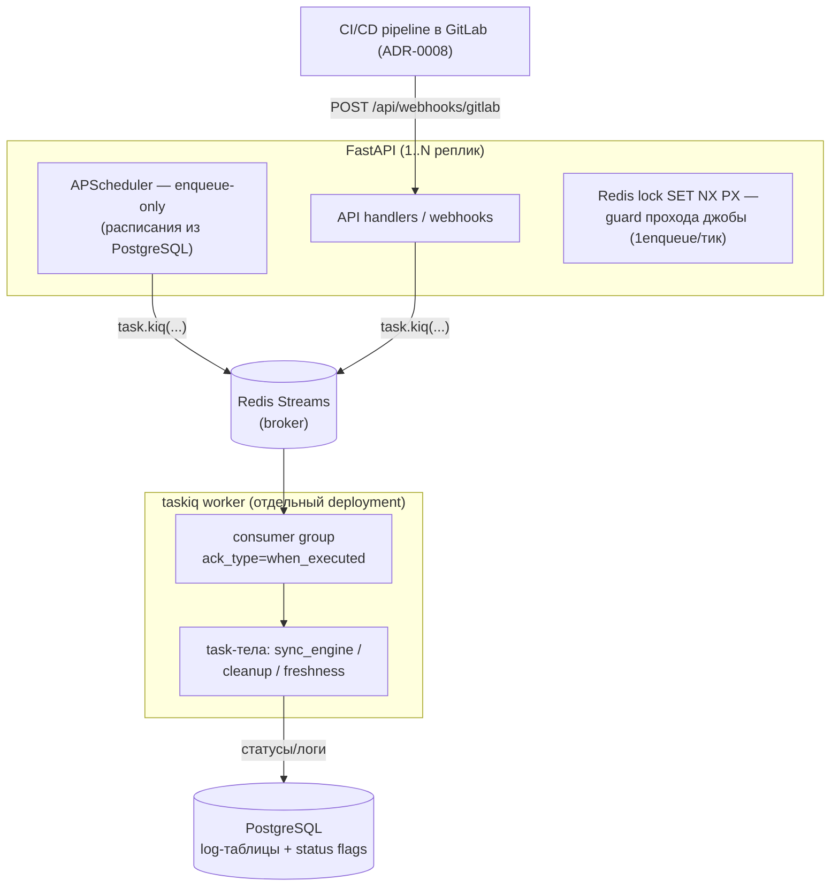

# Background tasks: taskiq + Redis Streams; supersede ADR-0009

## Context and Problem Statement

[ADR-0009](../archive/backend/0009-pull-sync-apscheduler-webhooks.md) зафиксировал исполнение фоновой синхронизации in-process через APScheduler и явно объявил брокер задач non-goal («overengineering при текущем масштабе»). Собственные же revisit-триггеры ADR-0009 сработали:

- нужна **retry с backoff** — сейчас повтор = следующий крон или ручной запуск;
- планируется **>1 реплики** backend — in-process планировщик дублировал бы джобы;
- **scale-цели выросли** против «сотен зеркал» на момент ADR-0009.

По правилам реестра решение, противоречащее существующему ADR, требует нового ADR и архивации старого — этот документ. Вопрос: **какую модель исполнения фоновых задач зафиксировать** — task-очередь или что-то ещё (Temporal, доработка in-process)?

Решение принято на decision brief (grilling-сессия, 2026-10-24, adversarial review, все пункты подтверждены владельцем проекта). Любые изменения кода — вне этого ADR (Phase 1/2 issues).

## Decision Drivers

* **Надёжность исполнения**: at-least-once с ack после выполнения; задача, потерянная при рестарте пода, не должна исчезнуть
* **Retry с backoff** как встроенная механика, а не «следующий крон»
* **Горизонтальное масштабирование**: воркеры задач отделены от API-процесса, >1 реплики безопасно
* **Реестр задач — PostgreSQL**: расписания (`sync_cron`, `freshness_cron`, `BuildSchedule`) остаются доменными данными (ADR-0008, ADR-0020); статус задач — существующие log-таблицы и status-флаги
* **Инфраструктура уже есть**: Redis 7 в dev-стенде (redis-operator, ADR-0022/0029) — без новой внешней зависимости
* **Минимализм (ADR-0001)** — в его же терминах: одна лёгкая библиотека (taskiq) вместо зоопарка in-process обходных путей (лидеры, идемпотентность джоб, ручные retry)

## Considered Options

* **taskiq + `RedisStreamBroker`** (Redis Streams, consumer-group acks, at-least-once)
* Temporal (workflow engine, durable execution)
* Оставить in-process APScheduler и доработать его (leader-lock, retry вручную)
* Celery + Redis (рассматривался в ADR-0009 и отвергнут там же — аргументы не изменились, кроме самого вывода)

## Decision Outcome

Chosen option: **taskiq + `RedisStreamBroker`**. taskiq — лёгкая async-native очередь с минимумом концепций; Redis Streams дают consumer groups с ack-семантикой (at-least-once) без второй инфраструктуры. Celery отвергнут теми же аргументами, что и в ADR-0009 (тяжелее, sync-first, celery-beat всё равно отдельный планировщик); Temporal — отдельно ниже.

### Архитектура исполнения



Правила:

1. **APScheduler остаётся, но только как enqueue-only**: тела джоб заменяются на `task.kiq(...)`-публикации; расписание перечитывается из PostgreSQL, как сегодня. Проход каждой джобы защищён Redis-локом (`SET NX PX`) — при N репликах тик исполняет ровно один enqueue на задачу.
2. **Воркер — отдельный процесс/деплой** (taskiq worker), масштабируется независимо от API; consumer group распределяет задачи между воркерами.
3. **Без result backend** (`DummyResultBackend`): результат задачи — записи в PostgreSQL (существующие `MirrorLog` / `DockerSyncLog` / `HelmSyncLog` / `BuildLog`, status flags 0–4), а не в очереди. Статусная истина — БД, как и сейчас.
4. **Жёсткие дефолты брокера** (фиксируются конфигом, покрываются тестом — см. Confirmation):
   - `ack_type="when_executed"` — ack только после успешного выполнения (at-least-once, потеря пода → redelivery);
   - `max_retries=3`;
   - `idle_timeout=30 min` — это `min-idle-time` для XAUTOCLAIM и он **должен превышать максимальную длительность задачи**: дефолт библиотеки 10 мин дублирует долгие sync'и (второй воркер подхватывает ещё живую задачу);
   - явный `unacknowledged_lock_timeout` — обход taskiq-redis [#131](https://github.com/taskiq-python/taskiq-redis/issues/131): autoclaim-лок без таймаута после SIGKILL пода висит вечно, unacked-задачи не переезжают.
5. **Graceful shutdown**: worker `terminationGracePeriodSeconds=360`, `wait_tasks_timeout=300` — pod получает 5 минут на доигрывание задач, ack'ает их и выходит; недоигранные — redelivery.
6. **Без DLQ-стрима** в этой миграции: исчерпание `max_retries` — только лог (существующие log-таблицы + status flag=1). DLQ — кандидат в revisit при появлении требований к ручному разбору.
7. **Sync-тела задач** консолидируются вокруг ядра `sync_engine.py` (выделение — Phase 1 issue); ядро hand-reviewed, импорты в него ограничены — см. guardrails Temporal-вердикта и skill `.opencode/skills/sync-engine/`.

### Non-goals (с revisit-триггерами)

* RabbitMQ / другой брокер — см. триггеры ниже
* DLQ-стрим — при появлении требований к ручному разбору упавших задач
* Глобальный concurrency limiter / шардирование очередей / dedup-ключи — при доказанной конкуренции задач за ресурсы
* Notification center — отдельный домен, не задача очереди
* 503-middleware + k8s-API «maintenance mode» — первая итерация без него

### Scale-headroom

| Горизонт | Задач/день (оценка) | Redis Streams headroom | Комментарий |
|---|---|---|---|
| Сегодня (фактический) | десятки–сотни | ~4 порядка | очереди простаивают |
| +1 год (прогноз) | единицы тысяч | ~3 порядка | без изменений конфигурации |
| Предел до revisit | ~10⁵–10⁶ задач/день | — | триггер RabbitMQ ниже |

Redis Streams на одном инстансе обрабатывает десятки тысяч публикаций/сек — на всех горизонтах до revisit узким местом будут не очереди, а сами sync-операции (внешние API, CI-пайплайны).

### Revisit-триггеры (критерии переключения на RabbitMQ)

* Устойчивый поток >10⁵ задач/день или >10⁴ задач/час
* Потребность в routing-топологии (topic/exchange, per-tenant очереди)
* Потребность в приоритетных очередях / шардировании, не выражаемая consumer groups
* Redis Streams становится операционным узким местом (лаг consumer group растёт при штатной нагрузке)

### Temporal: почему отвергнут — условно, с обязательными guardrails

Temporal отвергнут как **overkill для текущего объёма** (durable workflows, отдельный кластер Temporal, SDK-объём) — но вердикт **условный**: отказ от очереди в пользу DIY-исполнения допустим только при удержании четырёх обязательных guardrails, компенсирующих то, что Temporal даёт из коробки:

1. **Hand-reviewed `sync_engine.py` core** — ядро исполнения синхронизаций проходит ручное ревью, изоляция импортов (см. skill)
2. **Chaos-тесты как CI merge gate** — suite, роняющий поды/брокер в прогоне; merge без зелёного chaos-гейта запрещён (Phase 2 issue)
3. **Lint bans** — правило линтера запрещает импорт тяжёлых/сетевых зависимостей в sync-ядре (fitness function)
4. **Agent-facing skill** — `.opencode/skills/sync-engine/`: правила написания task-тел, запрещённые импорты, указатель на этот ADR

Утрата любого из guardrails (например, chaos-гейт убрали из CI) — триггер переоткрытия вердикта Temporal-vs-DIY.

### Consequences

* Good, because at-least-once + retry с backoff «из коробки» — закрывает главный Bad из ADR-0009
* Good, because воркеры отделяются от API: N реплик API и произвольное число воркеров безопасно (consumer group + лок тика планировщика)
* Good, because Redis уже в стеке (ADR-0022/0029) — ни одной новой инфраструктурной зависимости
* Good, because расписания и статусы остаются доменными данными PostgreSQL — UI-контракты (ADR-0008, ADR-0020) не меняются
* Bad, because Redis Streams — at-least-once: task-тела обязаны быть идемпотентными или безопасно-повторяемыми; это дисциплина, а не механика
* Bad, because +1 deployment-юнит (worker) в helm chart (ADR-0023) и +1 библиотека (taskiq, taskiq-redis)
* Bad, because Redis Streams беднее полноценного брокера: нет routing/priorities/DLQ из коробки — осознанно, см. non-goals и revisit-триггеры
* Bad, because unacked-задачи после SIGKILL зависят от ручной конфигурации таймаутов (taskiq-redis #131) — неверно выставленный `unacknowledged_lock_timeout`/`idle_timeout` возвращает дублирование долгих sync'ов
* Neutral, because APScheduler никуда не девается — меняется только тело джоб (enqueue вместо исполнения); cron-семантика и `schedule_all_jobs()` сохраняются

### Confirmation

Тесты этой секции фиксируют артефакты, которые создаются в Phase 1/2 issues (код в этом ADR не меняется); до их появления секция — чеклист ревью.

```bash
# 1. Chaos gate (guardrail 2; Phase 2 issue): unacked-задача переживает
#    рестарт воркера — redelivery и ack. Merge gate: suite зелёный.
make test-unit-backend TEST_ARGS="tests/unit/broker/test_chaos.py -v"

# 2. Дефолты брокера (пункт 4 Decision): конфиг брокера фиксирует
#    ack_type=when_executed, max_retries=3, idle_timeout=1800,
#    unacknowledged_lock_timeout, DummyResultBackend.
make test-unit-backend TEST_ARGS="tests/unit/broker/test_broker_config.py -v"

# 3. Enqueue-only планировщик (пункт 1): тела джоб публикуют task.kiq(...),
#    локальный исполнения нет; проход джобы берёт Redis-лок (SET NX PX).
make test-unit-backend TEST_ARGS="tests/unit/test_scheduler.py -k kiq -v"
```

Правило линтера (guardrail 3, Phase 1 issue): запрет импортов в `sync_engine.py` (сетевые клиенты, планировщик, API-слой) — проверка в `make lint`.

## Pros and Cons of the Options

### taskiq + Redis Streams — chosen

* Good, because async-native (ADR-0001): taskiq — asyncio-first, не требует отдельного sync-моста
* Good, because Redis Streams: consumer groups, ack, XAUTOCLAIM — персистентность и at-least-once без второй системы
* Good, because минимум концепций: task + broker + worker; не workflow engine
* Bad, because экосистема моложе Celery; известные баги уровня библиотеки (taskiq-redis #131) закрываются конфигом, а не апгрейдом

### Temporal

Durable workflows, retry/таймауты/сигналы из коробки, история исполнения в движке.

* Good, because durable execution: состояние workflow переживает любой сбой без идемпотентности со стороны тела
* Bad, because отдельный кластер Temporal (+ БД под него) ради очереди задач, у которых нет долгоживущих workflow-состояний — непропорционально (ADR-0001 минимализм)
* Bad, because SDK-объём и порог входа выше всей текущей фоновой механики
* Verdict: отвергнут условно; при деградации guardrails 1–4 вердикт переоткрывается

### In-process APScheduler + ручные доработки

Развитие ADR-0009: leader-lock, retry-таблица, идемпотентность джоб.

* Good, because ноль новых процессов и зависимостей
* Bad, because каждая «коробочная» фича очереди (retry backoff, redelivery, ack) изобретается и поддерживается вручную — суммарный код и риск выше одной библиотеки
* Bad, because планировщик в API-процессе: latency пиков sync'ов бьёт по запросам; масштабирование планировщика ≠ масштабирование исполнения
* Bad, потому что revisit-триггеры ADR-0009 уже сработали — статус-кво не покрывает требования

### Celery + Redis

* Good, because зрелые retry/priorities/результаты
* Bad, because sync-first API в async-стеке; +2 зависимости; celery-beat — всё равно отдельный планировщик (аргументы ADR-0009 без изменений)
* Bad, because при уже принятом решении «очередь нужна» Redis Streams покрывают те же потребности меньшей ценой

## More Information

* Заменяет: [ADR-0009](../archive/backend/0009-pull-sync-apscheduler-webhooks.md) (архивирован как superseded; revisit-триггеры оттуда сработали)
* Стек и минимализм: [ADR-0001](0001-choose-backend-stack.md); провайдеры/credentials: [ADR-0007](../common/0007-providers-v3-registry.md); домен зеркалирования: [ADR-0008](0008-git-mirroring-github-app.md) — расписания остаются доменными данными
* Image builds (расписания `BuildSchedule`, enqueue-модель касается и их): [ADR-0020](0020-image-builds-gold-app.md)
* Инфраструктура: Redis — redis-operator в kind ([ADR-0022](../infrastructure/0022-dev-stand-on-kind.md), [ADR-0029](../infrastructure/0029-dev-stand-k8s-entities-via-opentofu-base-apps-split.md)); деплой worker'а — расширение helm chart ([ADR-0023](../infrastructure/0023-bigbug-helm-chart.md))
* taskiq-redis #131 (autoclaim-лок без таймаута): https://github.com/taskiq-python/taskiq-redis/issues/131
* Реестр ADR и конвенции: [docs/adr/README.md](../README.md)
* Agent-facing skill (guardrail 4): `.opencode/skills/sync-engine/SKILL.md`
