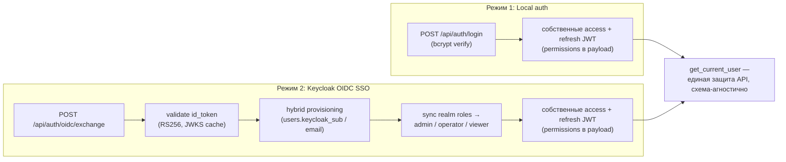
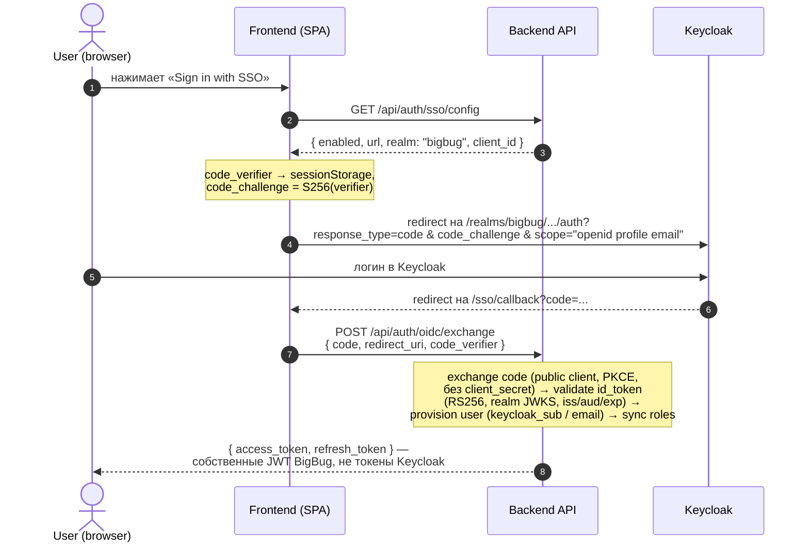

# Выбрать dual-mode аутентификацию: локальный email/password JWT + опциональный Keycloak OIDC SSO

## Context and Problem Statement

Каким способом аутентифицировать пользователей BigBug — централизованной DevOps-платформы, которая деплоится как в окружения с корпоративным IdP (Keycloak), так и в изолированные стенды без него?

Функциональность уже реализована в двух режимах, но само решение и его обоснование нигде не зафиксированы как ADR — оно живёт только в эксплуатационной документации (`plans/features/auth-rbac.md`) и в коде. Этот ADR фиксирует решение по аутентификации; модель авторизации (RBAC permissions) — отдельный ADR-0004.

## Decision Drivers

- BigBug — self-hosted платформа для DevOps-команд, у которых уже есть корпоративный Keycloak (модуль `infrastructure/terraform/infra-apps/modules/keycloak_conf/` разворачивает realm `bigbug` вместе с GitLab/Harbor)
- Платформа должна работать и без Keycloak: pure-local deployments (docker-compose без infrastructure-стека) — SSO опционален
- Роли из IdP должны маппиться на локальную RBAC-модель (`admin` / `operator` / `viewer`); локальная модель — источник истины для permissions
- Frontend — SPA (React): implicit flow запрещён, нужен Authorization Code + PKCE
- REST API не должен зависеть от схемы аутентификации: клиенты всегда получают собственные JWT платформы, а не токены Keycloak
- Секреты в БД шифруются при хранении (Fernet) — единая политика с credentials providers

## Considered Options

* Только локальная аутентификация (email/password + собственные JWT, SSO нет)
* Только SSO (Keycloak обязателен, локальных пользователей нет)
* Серверные сессии (cookie + server-side session store) вместо JWT
* Dual mode: локальная аутентификация + опциональный Keycloak OIDC SSO с гибридным provisioning'ом пользователей

## Decision Outcome

Chosen option: **Dual mode — локальная аутентификация (username/password + собственные JWT) как режим по умолчанию, плюс опциональный Keycloak 26 OIDC SSO через Authorization Code + PKCE**, потому что только этот вариант одновременно закрывает оба драйвера развёртывания (с Keycloak и без), не добавляет обязательной инфраструктуры и оставляет API scheme-агностичным.

Оба режима сходятся в одну точку — собственные JWT BigBug и единую проверку `get_current_user`:

### Режим 1: Local auth (по умолчанию)

- `POST /api/auth/login` {username, password} → проверка bcrypt-хеша (`backend/app/core/security.py`) → собственные access + refresh JWT
- Пароли задаёт только admin через Admin UI (`POST /api/admin/users`); самостоятельной регистрации нет
- В JWT payload вшиваются `permissions` (кэш RBAC — `require_permission()` работает без запроса в БД на каждый endpoint)
- Пользователи без пароля (`hashed_password IS NULL`) по local-логину недоступны (401)

### Режим 2: Keycloak OIDC SSO (опциональный)

Поток Authorization Code + PKCE (S256), публичный frontend-клиент Keycloak:

Серверная часть (`backend/app/services/oidc.py`, `KeycloakOIDCService`):

- **Обмен кода** на токены Keycloak — с `client_id` публичного frontend-клиента и `code_verifier`, **без client_secret** (public client полагается только на PKCE)
- **Валидация id_token**: подпись RS256 по realm JWKS (кэш в памяти, TTL из настроек), issuer, audience (= frontend client_id), exp
- **Гибридный provisioning** — SSO-пользователи живут в той же таблице `users`: поиск по `keycloak_sub`, fallback по email (существующая локальная учётка линкуется к SSO вместо дублирования); при создании — `hashed_password = NULL` (SSO-only аккаунт). Атрибуты (email, username, full_name) синхронизируются из claims при каждом входе
- **Синхронизация ролей**: realm roles из `realm_access.roles` сопоставляются с локальными `RoleName` (`admin` / `operator` / `viewer`) по точному имени; нераспознанные роли игнорируются; назначения приводятся к полному соответствию IdP (добавление + удаление). Поле `role_mapping` (JSON) в конфиге хранится, но логикой синхронизации пока не применяется — маппинг фактически «роль Keycloak = роль BigBug с тем же именем»
- После provisioning backend выпускает **собственные** access/refresh JWT со встроенными permissions — весь остальной API не знает, каким способом пользователь вошёл

### Хранение конфигурации SSO

- Singleton-таблица `oidc_config` (модель `backend/app/models/oidc_config.py`): `issuer_url`, `client_id` (confidential, для будущих server-to-server нужд), `client_secret`, `frontend_client_id`, `public_url`, `enabled`, `role_mapping`
- `client_secret` шифруется Fernet при записи (`app/core/secrets.py`); через API никогда не отдаётся — только маска `********`
- Чтение — через process-wide кэш с TTL 60 c (`OIDCConfigService`); обновление конфига инвалидирует кэш
- Нет строки в БД → SSO disabled (fallback на env-переменные не выполняется; env остаётся для инфраструктурных дефолтов — URL Keycloak, таймауты)
- Управление — admin API `GET|PATCH /api/auth/admin/oidc-config` с правами `oidc:read` / `oidc:write`
- Realm `bigbug` захардкожен в сервисе; клиенты Keycloak описаны Terraform'ом: `backend` (confidential), `frontend` (public, PKCE S256 обязателен), `harbor` (confidential)

### Consequences

* Good, because платформа работает в обоих окружениях: с корпоративным IdP и без него — SSO просто скрыт (`enabled=false`)
* Good, because API остаётся scheme-агностичным: один механизм защиты endpoints (`get_current_user` по собственному JWT) для обоих режимов
* Good, because гибридный provisioning сохраняет единую таблицу пользователей и локальную RBAC как источник истины — SSO не может раздуть модель прав
* Bad, because два кодовых пути аутентификации нужно поддерживать и тестировать одновременно
* Bad, because публичный клиент + PKCE означает, что решение о доверии коду целиком на стороне Keycloak redirect URI — их нельзя ослаблять
* Neutral, because `role_mapping` и `client_secret` в конфиге хранятся, но текущим exchange/синхронизацией не используются (задел; применение — отдельное решение)
* Neutral, because realm `bigbug` захардкожен — multi-realm не поддерживается
* Non-goals: удаление `plans/features/auth-rbac.md` (принадлежит ADR-0004); RBAC permission-модель и права (ADR-0004); multi-realm / несколько IdP; применение хранимых `role_mapping` и `client_secret` в exchange; **управление паролями пользователем (self-service change/reset) — не реализовано и не решено**: endpoint'ы `change-password`/`reset-password` из legacy-документации никогда не существовали в коде; пароли задаёт только admin через Admin UI (см. Режим 1). Появление самостоятельной смены/сброса пароля — отдельное решение новым ADR (требует email-канала для reset).

### Confirmation

1. Unit-тесты сервиса: `backend/tests/unit/test_oidc.py` — `test_exchange_code_success`, `test_validate_id_token_success/expired/bad_signature`, `test_provision_or_update_user_new/existing/find_by_email`, `test_sync_roles_add_and_remove/unknown_ignored/none`. Запуск: `make test-unit-backend TEST_ARGS="tests/unit/test_oidc.py -v"` — все зелёные.
2. Unit-тесты фронтенда: `frontend/src/tests/unit/keycloak.service.test.ts` (PKCE-хелперы, построение URL). Запуск: `make test-unit-frontend TEST_ARGS="keycloak"`.
3. E2E-инвариант scheme-агностичности: `backend/tests/e2e/test_auth.py` — ответ `oidc/exchange` содержит собственные `access_token`/`refresh_token`; `test_oidc_config.py` — `client_secret` никогда не возвращается в открытом виде.
4. Fitness-правило: в `frontend/package.json` нет runtime-зависимости от keycloak-js (авторизация строится напрямую из `/sso/config`); конфиденциальные токены Keycloak не выдаются клиентам — только собственные JWT.

## Pros and Cons of the Options

### Только локальная аутентификация

* Good, because ноль внешних зависимостей; простейшая модель угроз
* Bad, because отдельные пароли для DevOps-платформы в окружении, где уже есть корпоративный Keycloak, — антипаттерн; отключённые в IdP сотрудники остаются активными в BigBug
* Bad, because нет SSO — блокирует интеграцию Keycloak → Harbor → BigBug в едином контуре

### Только SSO (Keycloak обязателен)

* Good, because один путь аутентификации; пароли вообще не хранятся
* Bad, because ломает pure-local deployments: минимальный docker-compose стенд без infrastructure-стека не аутентифицируется вообще; первый вход и seed-админ невозможны без развёрнутого Keycloak
* Bad, because жёсткая связанность платформы с конкретным IdP при старте/демо

### Серверные сессии (cookie + session store) вместо JWT

* Good, because мгновенный отзыв сессии сервером; нет проблем с refresh-ротацией
* Bad, because требует server-side хранилища сессий (Redis) и sticky-логики для горизонтального масштабирования; ломает текущую безгосударственную проверку `get_current_user` и кэш permissions в JWT
* Bad, because SPA + API на разных портах в dev → CSRF-обвязка; текущие JWT Bearer-схемы проще

### Dual mode: local + optional Keycloak OIDC SSO — chosen

* Good, because покрывает оба драйвера развёртывания; SSO — фича, а не требование
* Good, because гибридный provisioning не плодит сущности: один `users`, SSO-аккаунт отличим только `keycloak_sub` + пустым паролем
* Good, because собственные JWT изолируют API от IdP: смена/отключение Keycloak не меняет контракт API
* Bad, because два пути = двойная поверхность тестирования и поддержки
* Bad, because часть конфига (`role_mapping`, `client_secret`) сейчас мёртвая — риск ввести в заблуждение администратора

## More Information

- Источники реализации: `backend/app/services/oidc.py`, `backend/app/services/oidc_config.py`, `backend/app/api/auth.py`, `backend/app/core/security.py`, `frontend/src/services/keycloak.ts`, `frontend/src/hooks/useKeycloakAuth.ts`, `infrastructure/terraform/infra-apps/modules/keycloak_conf/clients.tf`
- Эксплуатационная документация: `plans/features/auth-rbac.md` (SSO-разделы этого файла принадлежат данному ADR; файл целиком удаляет ADR-0004)
- Связанные ADR: ADR-0001 (backend-стек: authlib/python-jose/Fernet в стеке), ADR-0004 (RBAC permission model — модель прав, на которую опирается синхронизация ролей)
- Расхождение с документацией: в `plans/features/auth-rbac.md` описан словарь `KEYCLOAK_ROLE_MAPPING` (`bigbug-admin` → `admin`) и callback `POST /api/auth/sso/callback` — в коде их нет; фактически роли сопоставляются по точному имени (`admin`/`operator`/`viewer`), а endpoint — `POST /api/auth/oidc/exchange` с PKCE. Источник истины — код и этот ADR
- Условие пересмотра: появление требования multi-realm / нескольких IdP, применение хранимых `role_mapping`/`client_secret` в exchange, либо переход на server-side сессии — новым ADR
