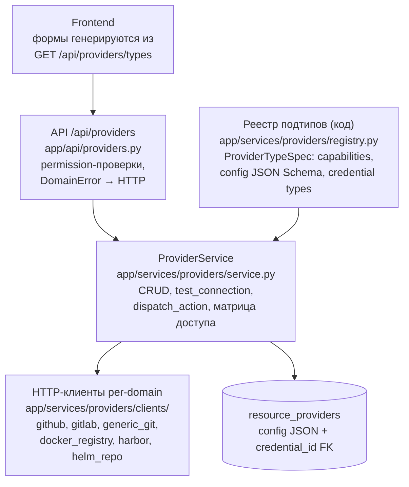
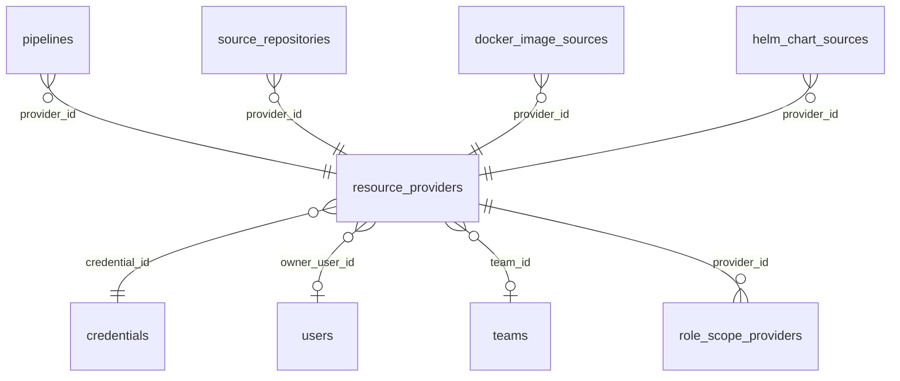

# Providers V3: единая сущность `resource_providers` с реестром подтипов в коде вместо 5 инстанс-таблиц и V2 `source_providers`

## Context and Problem Statement

Внешние интеграции платформы (Git, Docker/OCI registry, Helm) исторически были разбросаны по трём параллельным системам:

1. **5 копипастных таблиц-инстансов** — `gitlab_instances`, `github_instances`, `harbor_instances`, `docker_registry_instances`, `helm_repository_instances`, каждая со своей парой роутер+сервис (`api/integrations/*`, `services/integrations.py` на ~970 строк), своим фронтенд-табом и собственными колонками секретов (`token`/`password`) рядом с уже существующим Fernet-хранилищем `credentials.encrypted_secret`;
2. **V2-система `source_providers`** — отдельная сущность только для git-источников зеркалирования (модель `source_providers`, dispatcher, свои роуты в `mirroring.py`);
3. Легаси-модели `github_orgs`/`github_projects` без связи с инстансами.

Добавление одного нового типа интеграции требовало: новой таблицы, миграции, роутера, сервиса, стора, фронтенд-таба и hand-written формы. Секреты дублировались в двух местах с разными гарантиями. Вопрос: **принимать ли реализованную унификацию (Providers V3) как архитектурный стандарт** — одна таблица `resource_providers`, реестр подтипов в коде, единый `/api/providers`?

Миграция фактически завершена (фазы 0–7 из `plans/features/providers-unified.md`, включая фазу 7 — DROP legacy-таблиц и удаление `api/integrations/*`); ADR фиксирует решение задним числом. Слоение «API → сервис → ORM» зафиксировано в [ADR-0005](../backend/0005-service-layer-no-repository.md), схема БД и конвенции — в готовящемся ADR-0006 (PostgreSQL/Alembic).

## Decision Drivers

* Копипаста: 5 почти идентичных таблиц + 5 пар роутер/сервис + 5 фронтенд-табов; расхождение логики (test_connection, листинги) между копиями
* Секреты: дублирование `Credential.encrypted_secret` и колонок `token`/`password` в инстанс-таблицах — два места хранения с разным уровнем защиты
* Секреты не должны быть доступны в пользовательском `config` — нужен механизм, исключающий их появление (валидация, а не дисциплина ревью)
* Frontend: формы создания/редактирования интеграций писались вручную под каждый тип; metadata-driven подход устраняет эту работу
* Расширяемость: новый тип интеграции = запись в реестре + тонкий HTTP-клиент, без миграций схемы и новых роутеров
* Минимализм (ADR-0001): одна таблица вместо шести; реестр в коде вместо справочной таблицы в БД

## Considered Options

* Единая таблица `resource_providers` + реестр подтипов в коде + `/api/providers` (реализовано)
* Сохранить 5 отдельных инстанс-таблиц (status quo до миграции)
* Оставить V2 `source_providers` как единственную систему для git + точечные доработки остальных доменов
* Единая таблица, но реестр подтипов в БД (справочная таблица + seed)

## Decision Outcome

Chosen option: **Единая таблица `resource_providers` + реестр подтипов в коде + `/api/providers`** — она уже реализована и покрыта тестами; устраняет копипасту и дублирование секретов, делает добавление интеграции задачей «один файл реестра + один клиент», а фронтенд-формы генерируются из метаданных реестра.

### Ключевые решения

1. **Одна таблица `resource_providers`** вместо 5 инстанс-таблиц и `source_providers`. Специфика подтипа — в колонке `config` (JSON), валидируемой per-subtype JSON Schema из реестра (`extra="forbid"` — неизвестные ключи отклоняются). Категория/направление/домен/подтип — поля-enum, а не отдельные таблицы.
2. **Реестр подтипов живёт в коде** (`backend/app/services/providers/registry.py`), не в БД: декларативный `ProviderTypeSpec` (capabilities, допустимые categories/directions/credential types, JSON Schema конфига, флаги `oci_compliant`/`requires_base_url`, ограничители capability по паре (category, direction)). Правило: справочник, меняющийся только вместе с кодом (нужен клиент и валидация), не выносится в БД.
3. **Все секреты — только в `credentials`** (Fernet, `ENCRYPTION_KEY`); у провайдера — `credential_id` FK. В `config` секреты запрещены трёхуровнево: JSON Schema без секретных полей + deny-list по именам ключей в Pydantic-схеме + отсутствие секретных полей в метаданных реестра (UI-поле физически не генерируется).
4. **Категории — ось владения, visibility — ось видимости** (ортогональны): `category` = `system`/`public`/`private` (system — провайдеры самой платформы; создаются только вручную админом, API-создание запрещено независимо от прав), `visibility` = `owner`/`team`/`public` (шаринг команде = `visibility=team` + `team_id`, категория не меняется). Шаринг ровно одной команде — колонки на провайдере, link-таблица `provider_shares` отвергнута (YAGNI, потолок зафиксирован: миграция колонки в link-таблицу при появлении мульти-шаринга).
5. **Матрица доступа по категории — в `ProviderService`**: system — мутации только `providers_system:write` и скрытие от обычных пользователей; private — владелец + `providers:read_all` + team-membership; `is_protected` → запрет DELETE (409); удаление блокируется при живом usage (pipelines, source_repositories, docker_image_sources, helm_chart_sources, gitlab_projects).
6. **Capability-модель действий**: `dispatch_action` проверяет capability против реестра с учётом (category, direction); `trigger_pipeline` зарезервирован за `gitlab`+`system`+`internal`.

### Схема





Доменные таблицы-потребители ссылаются на провайдера через `provider_id` FK; владельцы данных — только `resource_providers` и `role_scope_providers`.

### Consequences

* Good, because добавление нового типа интеграции — запись в реестре + клиент в `clients/`; схема БД и роутеры не меняются
* Good, because секреты существуют в одном месте (`credentials`, Fernet); колонки `token`/`password` удалены вместе с инстанс-таблицами (фаза 7)
* Good, because фронтенд-формы генерируются из `GET /api/providers/types` — новые подтипы появляются в UI без правок фронтенда
* Good, because единая матрица доступа в одном сервисе вместо 5 копий; категория/направление — данные, а не структура таблиц
* Bad, because `config` (JSON) не типизируется на уровне БД — целостность держится на валидации Pydantic + JSON Schema реестра, а не на констрейнтах СУБД
* Bad, because универсальная таблица не даёт NOT NULL под «обязательное поле подтипа» (например, `base_url` для generic) — проверка только в реестре/сервисе
* Neutral, because legacy `ProviderType` enum в `models/provider_type.py` сохранён для V2 git-mirroring движка; V2-клиенты git (`services/source_providers/`) переиспользуются как слой поверх `resource_providers`
* Non-goals: мульти-шаринг провайдера нескольким командам (потолок зафиксирован); отдельный индексинг Helm-чартов как OCI-артефактов; ротация `ENCRYPTION_KEY` (владелец — будущий ADR-0010 про secrets, куда переходит соответствующий раздел из удалённого `plans/features/integrations.md`); реестр провайдеров в БД

### Confirmation

Реестр и матрица доступа покрыты именованными unit/e2e-тестами (все существуют в репозитории):

```bash
# Реестр: полнота (каждый subtype имеет spec), согласованность с enums,
# capability-матрица (trigger_pipeline только gitlab+system/internal),
# oci_compliant=true для docker-подтипов
make test-unit-backend TEST_ARGS="tests/unit/test_provider_registry.py -v"

# CRUD + матрица доступа: 409 на удаление protected/используемого,
# изоляция private, system-мутации только providers_system:write
make test-unit-backend TEST_ARGS="tests/unit/test_provider_service_crud.py -v"

# Шаринг командам: share/unshare, owner+providers:share+членство
make test-unit-backend TEST_ARGS="tests/unit/test_providers_share.py -v"

# Секреты: ответы /api/providers* и /api/credentials* не содержат секрет,
# deny-list в config
make test-unit-backend TEST_ARGS="tests/unit/test_provider_security.py -v"

# e2e: GET /types, CRUD, фильтры, permission-матрица по HTTP
make test-e2e-backend TEST_ARGS="tests/e2e/test_providers.py -v"
```

Fitness-проверка «интеграция не может появиться вне реестра»: `ProviderService.dispatch_action` и `create_provider` получают метаданные только через `get_spec()` из реестра — subtype без spec невозможен (KeyError). Ревью-чеклист новой интеграции: spec в `registry.py` → клиент в `clients/` → ветка в `_dispatch`/`_dispatch_test` → тесты clients. Запрет секретов в `config` — тест-кейсы deny-list в `test_provider_schema.py`.

Ожидаемый результат прогонов: все тесты зелёные; `test_provider_registry.py` падает при добавлении `ProviderSubtype` без spec.

## Pros and Cons of the Options

### Единая таблица + реестр в коде + `/api/providers` — chosen

Реализовано: модель `resource_providers` (проверенные CHECK-констрейнты `private→owner`, `team→team_id+private`, partial unique `name` WHERE не deleted и `is_default` per scope), реестр на 12 подтипов, единый сервис, клиенты, `/settings/providers` на фронте.

* Good, because устраняет копипасту таблиц/роутеров/сервисов/форм
* Good, because секреты в одном месте; валидация исключает их появление в `config`
* Good, because новый подтип — без миграции схемы
* Bad, because нет DB-уровня типизации `config` и per-subtype обязательности полей

### Сохранить 5 инстанс-таблиц

Status quo до миграции: таблица+роутер+сервис+таб на каждый тип.

* Good, because строгая типизация каждой сущности на уровне БД
* Bad, because копипаста размножает логику и баги; рассинхрон test_connection между 5 сервисами
* Bad, because секреты в двух местах (колонки инстансов + `credentials`)
* Bad, because новый тип интеграции = 6+ файлов и миграция

### V2 `source_providers` как единственная система

Развивать V2 (git-only) до покрытия docker/helm.

* Good, потому что одна миграция уже была сделана (V2 вместо V1-инстансов для git)
* Bad, потому что модель заточена под git-источники зеркалирования: нет категорий, нет owner-модели, нет docker/helm-доменов — обобщение потребовало бы тех же изменений, что V3
* Bad, потому что не решает ни дублирование секретов, ни копипасту docker/helm-инстансов

### Единая таблица + реестр в БД

Справочная таблица `provider_types` + seed вместо dataclass-реестра в коде.

* Good, потому что метаданные редактируются без деплоя
* Bad, потому что подтип бесполезен без кода (клиент, валидация) — рассинхрон «строка в БД есть, клиента нет» не ловится компиляцией/тестами
* Bad, потому что JSON Schema в БД не версионируется вместе с кодом клиента; миграции справочника — дополнительная обвязка без пользы (справочник меняется только вместе с кодом)

## More Information

* Исходный план миграции (фазы 0–7, таблица всех интеграций, ревизии 1–3): `plans/features/providers-unified.md` — **удалён** этим ADR как реализованный; факты о модели сверены с кодом и перенесены сюда
* Доменный гайд `plans/features/integrations.md` — **удалён**; troubleshooting-рецепты (curl-проверки GitLab/Harbor/Helm) перенесены в [AGENTS.md](../../AGENTS.md), раздел про ротацию Fernet-ключа — зона ответственности будущего ADR-0010 (secrets), сам текст сохранён в `plans/features/security.md`
* Реестр ADR и конвенции: [docs/adr/README.md](../README.md)
* Родственные ADR: [ADR-0005](../backend/0005-service-layer-no-repository.md) (сервисный слой и `DomainError` — паттерн, на котором построен `ProviderService`); ADR-0006 (PostgreSQL/Alembic, конвенции схемы — в подготовке); ADR-0003 (аутентификация); permissions-матрица `providers:*`/`teams:*`/`providers_system:write` — [plans/architecture/permissions.md](../../plans/architecture/permissions.md)
* Условие пересмотра: потребность в мульти-шаринге провайдера (несколько команд), в per-subtype индексируемых полях (фильтрация по config в SQL) или в справочнике подтипов, редактируемом без деплоя, — переоткрыть через новый ADR
