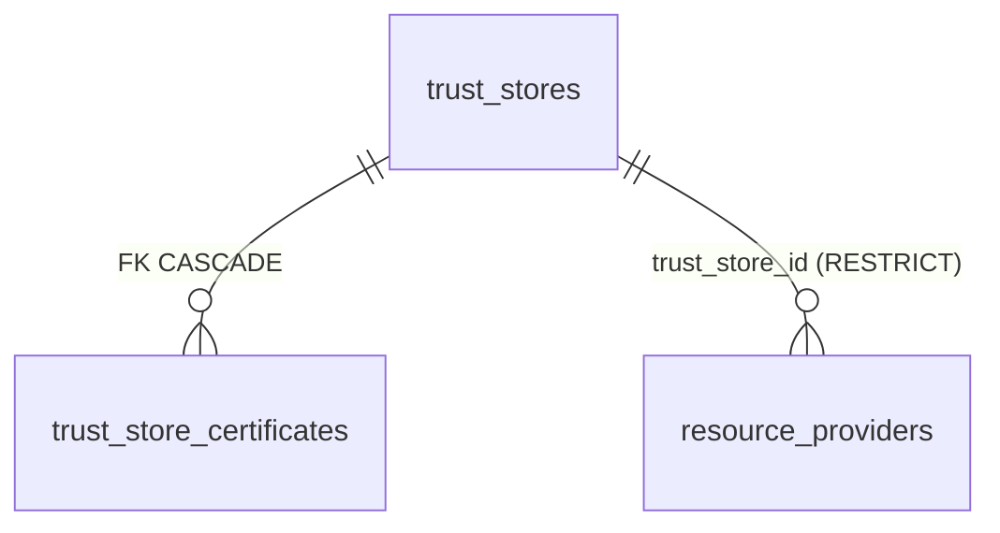

# Provider Trust Stores: именованные наборы CA-сертификатов как опциональный источник доверия для провайдеров

## Context and Problem Statement

[ADR-0028](0028-security-transport-cors-jwt-ttl.md) §2 зафиксировал единственный механизм управления доверием к внешним системам: per-provider bool-флаг `verify_ssl` на `resource_providers` (модель — `backend/app/models/resource_provider.py`, default `True`; семантика per-provider сохраняется). Практика показала gap: для self-signed HTTPS-эндпоинтов (GitLab, Harbor, helm-репозитории — штатная схема dev-стенда, [ADR-0030](../infrastructure/0030-dev-stand-https-self-signed-certs.md); типичный кейс корпоративных инсталляций) единственный доступный режим — **отключить проверку целиком** (`verify_ssl=false`), что открывает MITM-вектор на креды провайдера (сам ADR-0028 признаёт этот риск «Bad»-consequence'ом и запрещает его в production). Нет способа сказать «доверять именно этому CA, но проверять сертификат».

Вопрос: как дать админу точечный контроль над источником доверия для исходящего TLS провайдеров, не отключая проверку целиком и не превращая платформу в менеджер сертификатов?

Issue: [#88](https://github.com/SteeveRan/BigBug/issues/88) (решение согласовано на grilling-сессии), реализация — [#89](https://github.com/SteeveRan/BigBug/issues/89)/[#90](https://github.com/SteeveRan/BigBug/issues/90) (backend), [#91](https://github.com/SteeveRan/BigBug/issues/91)/[#92](https://github.com/SteeveRan/BigBug/issues/92) (frontend).

## Decision Drivers

* Self-signed HTTPS — штатный режим dev-стенда (единый CA стенда, ADR-0030) и частый кейс корпоративных GitLab/Harbor: требование «доверять этому CA, но проверять» — не экзотика, а основной путь
* `verify_ssl=false` — MITM-вектор на креды провайдера (Fernet-шифрование хранения, ADR-0010, не защищает канал); нужен режим без этого вектора
* Минимализм (ADR-0001, ADR-0007): не строить полноценный PKI-модуль — только именованные наборы CA + привязка провайдера
* Приложение централизует конфигурацию интеграций (Providers V3, ADR-0007) — источник доверия логично управлять там же, а не раскладывать по env/файлам подов
* httpx (в отличие от requests) игнорирует `SSL_CERT_FILE`/`REQUESTS_CA_BUNDLE` и строит trust store из certifi — уже есть обходной механизм `app/core/http.py::ssl_verify()` (бандл из env); трастсторы должны встраиваться в эту точку, а не дублировать её

## Considered Options

* Управляемый Trust Store: сущности `trust_stores` + `trust_store_certificates` в БД, провайдер ссылается опционально (chosen)
* Общий CA-бандл на весь инстанс BigBug (env-переменная `SSL_CA_BUNDLE` / файл в поде)
* Загружать CA-сертификат прямо в форму провайдера (поле в `config` провайдера)
* Статус-кво: только `verify_ssl` bool (отключение проверки целиком)

## Decision Outcome

Chosen option: **управляемый Trust Store** — именованный набор CA-сертификатов, на который провайдер ссылается опционально. Приложение получает CRUD-сущность; источник доверия отделяется от факта проверки: трастстор меняет, **чему** доверять, но проверка остаётся включённой.

### Сущности



* **`trust_stores`**: `name` — уникальный глобально, soft-delete aware (partial unique по аналогии с `resource_providers.name`); `description` — опциональное.
* **`trust_store_certificates`**: `name` — уникален внутри стора; `pem` — `Text` (PEM-блок CA-сертификата); `fingerprint` (SHA-256, вычисляется при сохранении — для отображения в UI и дедупликации); FK на стор с `ondelete=CASCADE` (удаление стора удаляет его сертификаты — они не имеют смысла вне стора).
* **`resource_providers.trust_store_id`** — nullable FK, `ondelete=RESTRICT`: молчаливая отвязка источника доверия запрещена. Удаление используемого стора → **409** со списком провайдеров, ссылающихся на него (паттерн usage-блокировки уже есть в ProviderService, ADR-0007 §5).

### Семантика verify_ssl × trust_store

Трастстор **не дублирует и не отменяет** семантику per-provider `verify_ssl` (ADR-0028 §2) — он добавляет недостающую ось «источник доверия»:

| `verify_ssl` | `trust_store_id` | Поведение исходящего TLS |
|---|---|---|
| `false` | любой | Без проверки (dev-режим, MITM-риск — как было; правило runbook: не для production) |
| `true` | задан | Проверка включена, доверие — **только из стора** (PEM стора заменяет системный набор) |
| `true` | null | Проверка включена, доверие — системный CA (сегодняшнее поведение) |

Инвариант: **трастстор меняет источник доверия, не отключая проверку**. Комбинация `verify_ssl=true` + стор даёт режим, который раньше был недостижим для self-signed эндпоинтов.

### Материализация PEM

Трастстор — данные в БД; при выполнении запроса PEM материализуется в объект, понятный конкретному клиенту:

* **httpx-клиенты** (`providers/clients/*` через `_http.py`): `ssl.SSLContext`, собранный из PEM в памяти (`ssl.create_default_context(cadata=...)`) — без промежуточных файлов; точка встраивания — существующий хелпер `app/core/http.py::ssl_verify()`, который сегодня возвращает путь env-бандла или `True`.
* **python-gitlab и git CLI** (git-mirroring, git-клиенты): нужен путь до файла на диске — бандл-кеш: `resolve_bundle_path(trust_store)` собирает PEM всех сертификатов стора в файл, регенерирует по хешу содержимого (изменился стор → изменился хеш → перезапись файла); путь передаётся как `REQUESTS_CA_BUNDLE`-аналог (`ssl_ca_certs` / `GIT_SSL_CAINFO`).

### RBAC

Управление трастсторами — отдельные permissions, симметрично `credentials:*`:

| Permission | Admin | Operator | Viewer |
|---|:---:|:---:|:---:|
| `trust_stores:read` | ✅ | ✅ | — |
| `trust_stores:write` | ✅ | — | — |

Логика: operator работает с провайдерами (`providers:write`) и должен видеть, какой стор привязан, но менять набор доверия платформы — право админа (аналогично `providers_system:write`). Просмотр PEM-содержимого публичных CA не опасен; `read` нужен operator'у для привязки стора к своему провайдеру.

### Known gaps (зафиксированные ограничения, вне скоупа)

Некоторые пути клиента не умеют принимать кастомный CA — для них `shortcut:`-комменты в коде при реализации:

* **PyGithub** (GitHub-клиент): нет API кастомного CA; работает только с системным доверием или `verify_ssl=false`
* **`crane copy`** (subprocess registry-синхронизации): не передаётся `--insecure`-эквивалент CA без флагов
* **cosign** (подпись образов, ADR-0020): аналогично — subprocess без проброса CA

Это известные дыры, не блокирующие решение: перечисленные пути используются для GitHub/OCI-операций, где системное доверие — норма; при появлении требования — отдельные задачи.

### Consequences

* Good, because режим «доверять этому CA, но проверять» закрывает главный недостаток bool-`verify_ssl` (ADR-0028): self-signed стенды больше не требуют полного отключения проверки
* Good, because MITM-вектор `verify_ssl=false` остаётся опциональным escape-hatch'ем, а не единственным способом работы с self-signed
* Good, because RESTRICT + 409 со списком провайдеров исключает молчаливую потерю источника доверия у работающих интеграций
* Good, because семантика ADR-0028 §2 не ломается: флаг сохраняется, трастстор — аддитивное расширение
* Bad, because новая сущность + CRUD + UI: часть платформы, которую нужно поддерживать (цена за точечный контроль)
* Bad, because PEM сторов лежат в БД открытым текстом — это осознанно (публичные сертификаты, не секреты; Fernet не нужен), но ревьюеры не должны «чинить» это шифрованием
* Bad, because известные gaps (PyGithub, crane, cosign) покрывают не все клиенты — часть путей всё ещё требует системного CA или отключения проверки
* Neutral, because soft-delete aware уникальность `name` повторяет паттерн `resource_providers` — без мягкого удаления самих трастсторов (удаление только жёсткое, через usage-гейт 409); паттерн взят для консистентности partial unique index'а
* Non-goals: полноценный PKI/CRL/OCSP; проверка цепочек и сроков действия сертов в UI; автоматическая ротация CA; трастсторы для входящих соединений (BigBug backend — HTTP за proxy, ADR-0028 §1); mTLS client-сертификаты (только CA доверия)

### Confirmation

* **SSLContext-инъекция** (unit): тест проверяет, что httpx-клиент с провайдером `verify_ssl=true` + `trust_store_id` получает `ssl.SSLContext`, собранный из PEM стора (инъекция фейкового CA в тестовом сторе; валидный серт, подписанный им, проходит, системный — отклоняется), а провайдер без стора — системный контекст. Появится с реализацией #90 как `backend/tests/unit/test_provider_trust_store_ssl.py` (имя зафиксировано для #90):

```bash
make test-unit-backend TEST_ARGS="tests/unit/test_provider_trust_store_ssl.py -v"
```

Ожидаемый результат: зелёный; при удалении инъекции контекста из `_http.py` — падает.

* **RESTRICT + 409** (unit): тест удаляет стор, на который ссылается провайдер → `IntegrityError`/`DomainError` транслируется в 409 с перечнем провайдеров. Появится как кейс в `backend/tests/unit/test_trust_store_service.py` (имя для #89):

```bash
make test-unit-backend TEST_ARGS="tests/unit/test_trust_store_service.py -v"
```

* Fitness: grep по `backend/app/services/providers/clients/` — все клиенты принимают trust-параметр через единый хелпер (`app/core/http.py`), без прямого чтения env; ревью-чеклист нового клиента: `verify=...` строится через хелпер, который учитывает `trust_store`.

## Pros and Cons of the Options

### Управляемый Trust Store — chosen

* Good, because точечный контроль: один self-signed Harbor не ослабляет проверку для остальных провайдеров
* Good, because RESTRICT-гейт не даёт молчаливо отвязать доверие от работающего провайдера
* Good, because семантика `verify_ssl` сохранена — аддитивное расширение, не миграция поведения
* Bad, because новая сущность + CRUD + UI + материализация в трёх видах (SSLContext, файл-кеш)
* Bad, because не все клиентские пути покрыты (PyGithub/crane/cosign)

### Общий CA-бандл на инстанс (env/файл)

* Good, because нулевая работа: механизм уже есть (`ssl_verify()` + `SSL_CERT_FILE` в entrypoint, ADR-0030)
* Bad, because один бандл на всех: добавить CA для одного GitLab — значит доверять ему всем клиентам инстанса, включая сторонние
* Bad, because управление вне приложения (файлы в поде, k8s Secrets/ConfigMap) — против идеи централизации конфигурации (ADR-0007)
* Bad, because не даёт «этот CA — только для этого провайдера»

### CA-сертификат в `config` провайдера

* Good, because без новых таблиц — поле в JSON-конфиге
* Bad, потому что переиспользование между провайдерами (один корпоративный CA на 5 GitLab) — копипаста PEM в каждый конфиг
* Bad, потому что PEM в `config` виден в API-ответах провайдера и UI-формах (config не секрет, но шумит), а валидация PEM в JSON Schema — громоздко
* Bad, потому что нет lifecycle: смена CA = правка каждого провайдера

### Статус-кво (только `verify_ssl` bool)

* Good, потому что ничего не менять
* Bad, потому что gap не закрывается: self-signed = отключение проверки = MITM-вектор, зафиксированный как принятый риск в ADR-0028 — риск оказался регулярным, а не исключительным

## More Information

* Реестр ADR и конвенции: [docs/adr/README.md](../README.md)
* Родственные ADR: [ADR-0028](0028-security-transport-cors-jwt-ttl.md) (модель транспорта, per-provider `verify_ssl` — этот ADR расширяет §2); [ADR-0007](0007-providers-v3-registry.md) (Providers V3: таблица `resource_providers`, паттерн usage-гейта, permission-матрица `providers:*`); [ADR-0030](../infrastructure/0030-dev-stand-https-self-signed-certs.md) (dev-стенд HTTPS: единый CA стенда — типичный кейс трастстора); [ADR-0010](../backend/0010-fernet-secrets-encryption.md) (что считается секретом: PEM публичных CA — не секрет, шифрование не применяется); [ADR-0006](../backend/0006-database-postgresql-alembic.md) (конвенции схемы, partial unique)
* Код (точки встраивания, текущее состояние): `backend/app/models/resource_provider.py` (`verify_ssl`), `backend/app/core/http.py` (`ssl_verify()` — env-бандл, предшественник трастстора), `backend/app/services/providers/clients/_http.py`
* Permissions: `trust_stores:read`/`trust_stores:write` — [docs/development/permissions.md](../../development/permissions.md); термин Trust Store — [GLOSSARY.md](../../../GLOSSARY.md)
* Происхождение: issue [#88](https://github.com/SteeveRan/BigBug/issues/88) — решения согласованы на grilling-сессии (включая RESTRICT вместо SET NULL, отказ от шифрования PEM, материализацию в память для httpx / в файл для git)
* Триггеры пересмотра: потребность в CRL/OCSP или клиентских mTLS-сертификатах; покрытие gaps (PyGithub/crane/cosign) станет требованием, а не известным ограничением
