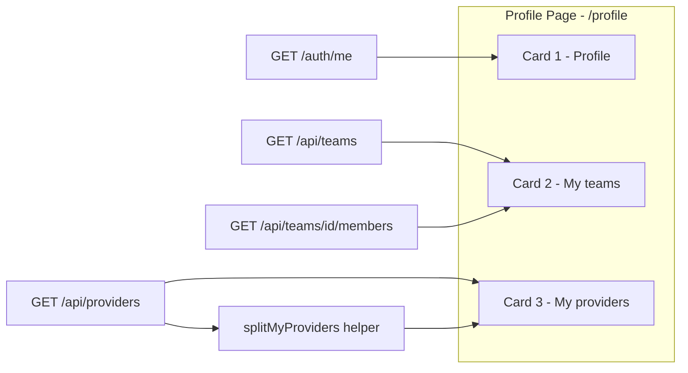

# Личный кабинет пользователя `/profile`: профиль, мои команды, мои провайдеры вместо `/settings/teams`

## Context and Problem Statement

У аутентифицированного пользователя нет «своей» страницы в BigBug:

- dropdown у аватара содержал только Sign Out;
- `/settings/teams` (старая страница `frontend/src/pages/Settings/Teams/`) — read-only таблица без состава команд;
- «My providers» не существовало вовсе: страница `/settings/providers` показывает общий scoped-список без группировки «мои / расшаренные на мои команды».

Дизайн-документ `plans/features/user-profile.md` (состав подтверждён владельцем: Профиль · Мои команды · Мои провайдеры) — вопрос: **какую форму принимает личный кабинет пользователя и на каких источниках данных он строится?**

Кабинет строится поверх auth и RBAC: [ADR-0003](../common/0003-keycloak-oidc-dual-auth.md) (идентичность из Keycloak SSO), [ADR-0004](../common/0004-permission-based-rbac-scope-providers.md) (roles, team sharing, scope-providers), [ADR-0007](../common/0007-providers-v3-registry.md) (единая сущность `resource_providers`).

Фактическое состояние на дату решения (проверено по коду): страница `frontend/src/pages/Profile/` реализована; настоящий ADR фиксирует дизайн-решение и снимает `plans/features/user-profile.md` с обслуживания.



## Decision Drivers

- Один домен — одна страница: три вопроса пользователя («кто я», «где я состою», «что мне доступно») отвечаются в одном месте; управление (admin/lead) остаётся в админке — кабинет read-only.
- Редактирование профиля вне scope: имя/email управляются Keycloak (SSO) или администратором (`UserUpdate` в `backend/app/schemas/auth.py` меняет email/roles только админу).
- Никаких новых backend-эндпоинтов и новых permissions: существующие `GET /api/teams`, `GET /api/teams/{id}/members`, `GET /api/providers`, `GET /api/auth/me` уже дают все данные с корректным per-request scoping.
- Минимализм (унаследован из ADR-0002): переиспользовать существующие RTK Query-хуки, компоненты и паттерны (PermissionGate, StatusChip, `roleColorMap`).

## Considered Options

* Единая страница `/profile` — вертикальный стек из трёх Card (chosen)
* Расширить Settings/Teams до полноценного кабинета
* Три отдельных страницы (Profile / Teams / Providers)
* Только dropdown у аватара (без отдельной страницы)

## Decision Outcome

Chosen option: **единая страница `/profile`** (роут `profile` внутри основного `Layout`, вне Settings, без `PermissionGate` на самом роуте — доступна каждому аутентифицированному) — вертикальный стек из трёх Card; вход из dropdown аватара («My Profile»), пункт Teams из sidebar удалён, `/settings/teams` заменён бессрочным redirect.

### Зафиксированные правила

**1. Три Card, без вкладок** (контента мало; вкладки добавляют клики):

| Card | Содержимое | Источник данных |
|---|---|---|
| Profile (read-only) | Аватар (первая буква username), `full_name` с fallback `username`, username, email, роли (`Tag` + `roleColorMap`), статус `is_active` (`Badge`) | Redux `state.auth.user` + `useGetMeQuery()` для актуализации |
| My teams | Таблица: Name, Description, Lead, My role (Lead gold / Member), Members count; expandable row — состав команды (username, роль, `joined_at`) лениво через `useGetTeamMembersQuery(teamId)` | `useGetTeamsQuery()` без `?all`; на клиенте `teams.filter(t => t.my_role !== null)` — защита от того, что админу сервис возвращает все команды |
| My providers | Таблица: Name, Type (`domain`+`subtype`), Access (`Owned` / `Shared: {team_name}`), Status (`StatusChip`), Actions («Manage» → `/settings/providers`); фильтр `Segmented` `All / Owned / Shared with teams` | Один `useGetProvidersQuery()`; деление на client-side helper `splitMyProviders(providers, userId, myTeamIds)` |

**2. `splitMyProviders`** (`frontend/src/pages/Profile/splitMyProviders.ts`) — чистая функция: `owned` = `owner_user_id === userId` (при `userId != null`); `shared` = `visibility === 'team' && team_id ∈ myTeamIds` (только реальные команды членства — `myTeamIds` строится из команд с `my_role !== null`). Второго запроса к API нет; query-параметр `owner=me` этой страницей не используется.

**3. Backend-гэп — единственное серверное изменение**: поле `full_name` пользователя.

- модель `users.full_name` (nullable, уже входит в `initial_schema` — миграция не требуется);
- `UserOut.full_name: str | None`, `get_me` отдаёт поле;
- OIDC: claim `name` → `full_name` (fallback `username` в `_extract_claims`), синхронизируется в `_create_user` / `_update_user`;
- frontend fallback `full_name ?? username` — страница работает до заполнения поля у существующих пользователей.

**4. Что НЕ вводится** (обоснование): `GET /teams/mine` (список уже scoped по членству + `my_role` в ответе); расширение `/auth/me` ролями (уже отдаются); отдельный эндпоинт «мои провайдеры» (scoping `providers:read` уже возвращает public + own + team-shared одним ответом); `PATCH /auth/me` (read-only кабинет, SSO-модель).

**5. Права: изменений нет.** Новые permissions не вводятся; гейтинг данных — backend per-request (`teams:read`, `providers:read` у A/O/V). Мягкая защита внутри карточек — `PermissionGate` с `fallback={<Empty>}` (устойчивость к будущим ролям без этих прав). В `docs/development/permissions.md` UI-привязка `teams:read` обновлена: `/settings/teams` → `/profile` (My teams).

**6. Судьба `/settings/teams`**: файл `frontend/src/pages/Settings/Teams/` удалён; роут заменён redirect `<Navigate to="/profile" replace />` (бессрочно — старые закладки); импорт `SettingsTeams` удалён. Админские `/admin/teams`, `/admin/teams/:teamId` не затрагиваются.

### Consequences

* Good, because один вход для пользователя: аватар → «My Profile» — вместо read-only таблицы Teams без состава и отсутствовавшего «My providers»
* Good, because ноль новых эндпоинтов и permissions: страница собирается из существующих RTK Query-хуков; серверный scoping остаётся единственным механизмом доступа
* Good, because read-only кабинет не дублирует админку: вся edit/share/delete-механика остаётся на `/settings/providers`, управление составом — в `/admin/teams`
* Bad, because деление провайдеров owned/shared — клиентское: при расхождении client-side фильтра с серверным scoping'ом поведение придётся синхронизировать вручную (unit-тесты helper'а фиксируют контракт)
* Bad, because «My Profile» в dropdown при SSO-логине требует настройки Keycloak mapper'а для claim `name`; без него имя = username (fallback заложен, поле nullable)
* Neutral, because redirect `/settings/teams → /profile` сохраняется бессрочно — небольшая постоянная нагрузка на роутер ради совместимости закладок

### Confirmation

1. **Helper-контракт** (owned/shared, защита от админских «всех команд», `userId=undefined`, чужой public не попадает никуда):

```bash
make test-unit-frontend TEST_ARGS="-f splitMyProviders"
```

Ожидаемый результат: все тесты `src/tests/unit/splitMyProviders.test.ts` зелёные.

2. **Страница**: рендер профиля (full_name + fallback username, роли), фильтр команд по `my_role`, деление провайдеров Owned/Shared, expand подгружает members, empty states:

```bash
make test-integrations-frontend TEST_ARGS="-f Profile"
```

Ожидаемый результат: все тесты `src/tests/integrations/Profile.test.tsx` зелёные.

3. **Backend `full_name`**: `/auth/me` отдаёт заполненное поле и `null`-fallback:

```bash
make test-unit-backend TEST_ARGS="-k full_name"
```

Ожидаемый результат: оба теста `backend/tests/unit/test_auth_me.py` зелёные.

4. **Роут/redirect** (ревью): в `frontend/src/router/index.tsx` существуют `<Route path="profile" ...>` (без `PermissionGate`) и `<Route path="settings/teams" element={<Navigate to="/profile" replace />} />`; каталог `frontend/src/pages/Settings/Teams/` отсутствует:

```bash
# ожидание: пусто
ls frontend/src/pages/Settings/Teams 2>&1
```

## Pros and Cons of the Options

### Единая страница `/profile` — стек из трёх Card — chosen

* Good, because три вопроса пользователя — одна точка входа; навигация из аватара естественна для «личного» (не настройки)
* Good, because вертикальный стек без вкладок: контента мало, всё видно скроллом без лишних кликов
* Bad, because страница собирает данные трёх доменов (auth, teams, providers) — чуть шире зона ответственности одного компонента (смягчено выносом `MyTeamsCard` / `MyProvidersCard` / `splitMyProviders`)

### Расширить Settings/Teams

Достроить состав команд и провайдеры внутри `/settings/teams`.

* Good, because минимальный дифф: роут, sidebar и permissions-привязка не меняются
* Bad, because «личный кабинет» — не настройка: место противоречит смыслу (вход из аватара, а не из Settings); сайдбар остаётся с пунктом, дублирующим кабинет
* Bad, because не решает отсутствие «My providers» в структуре Settings без ломающей страницы семантики

### Три отдельных страницы

`/profile`, `/profile/teams`, `/profile/providers` (или /settings/…).

* Good, because каждая страница узкая и маленькая
* Bad, because контента в каждом разделе мало — три клика ради трёх коротких таблиц; рост навигационного кода и redirect-матрёшки

### Только dropdown у аватара

Показывать профиль/команды/провайдеров вложенными пунктами меню без страницы.

* Good, because ноль новых роутов
* Bad, because dropdown не вмещает таблицы команд с expandable-составом и провайдеров со статусами; UX-паттерн для меню, а не для данных

## More Information

- Родственные ADR: [ADR-0003](../common/0003-keycloak-oidc-dual-auth.md) (идентичность SSO — источник профиля), [ADR-0004](../common/0004-permission-based-rbac-scope-providers.md) (roles, team sharing, scope-providers), [ADR-0007](../common/0007-providers-v3-registry.md) (`resource_providers`), [ADR-0002](0002-frontend-stack-react-antd-rtk.md) (frontend-стек), [ADR-0015](0015-frontend-unit-testing-vitest.md) (unit-конвенции — тесты `splitMyProviders`)
- Заменяет `plans/features/user-profile.md` (удалён настоящим ADR); индекс планов `plans/README.md` ссылается на ADR напрямую
- Источник истины по реализации: `frontend/src/pages/Profile/`, `frontend/src/router/index.tsx`, `frontend/src/components/Layout/index.tsx`, `backend/app/models/user.py`, `backend/app/services/oidc.py`
- Условие пересмотра: появление требования редактирования профиля (вне SSO-модели), серверная потребность в отдельном эндпоинте «мои провайдеры» (рост объёма данных), либо lead-функционал в кабинете — переоткрыть через новый ADR
- Известные остатки: claim `name` в Keycloak требует настройки mapper'а (инфраструктурная задача вне кода); устаревший комментарий в `frontend/src/tests/integrations/NavigationMenu.test.tsx` (упоминание Settings/Teams)
